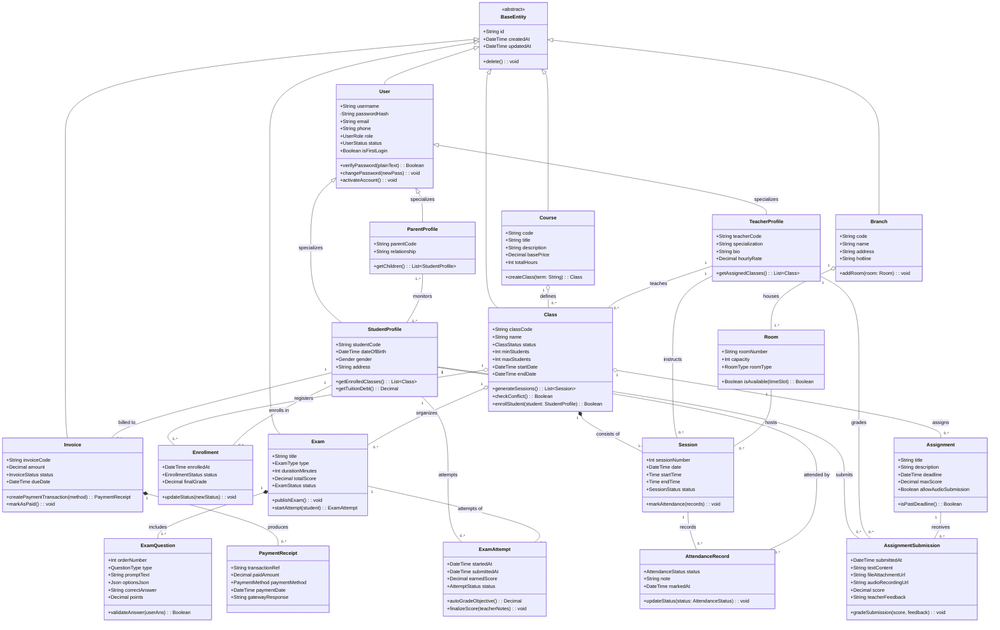
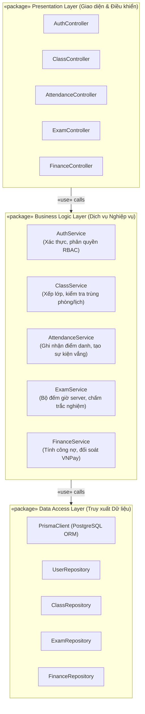
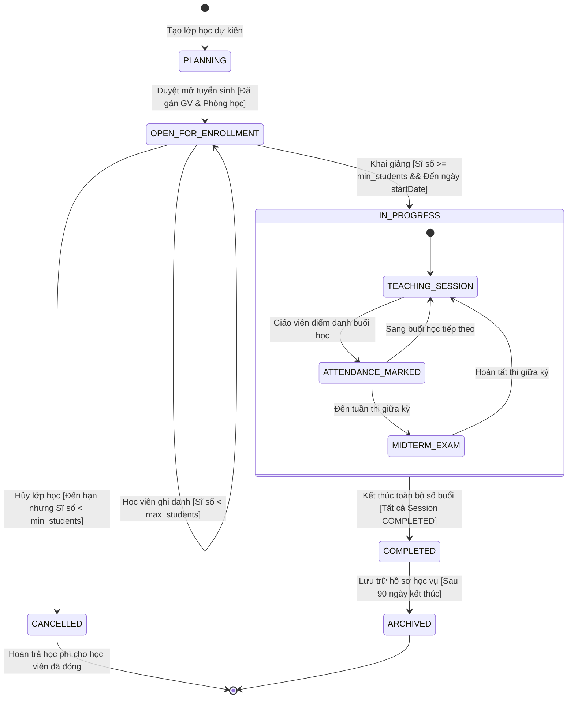
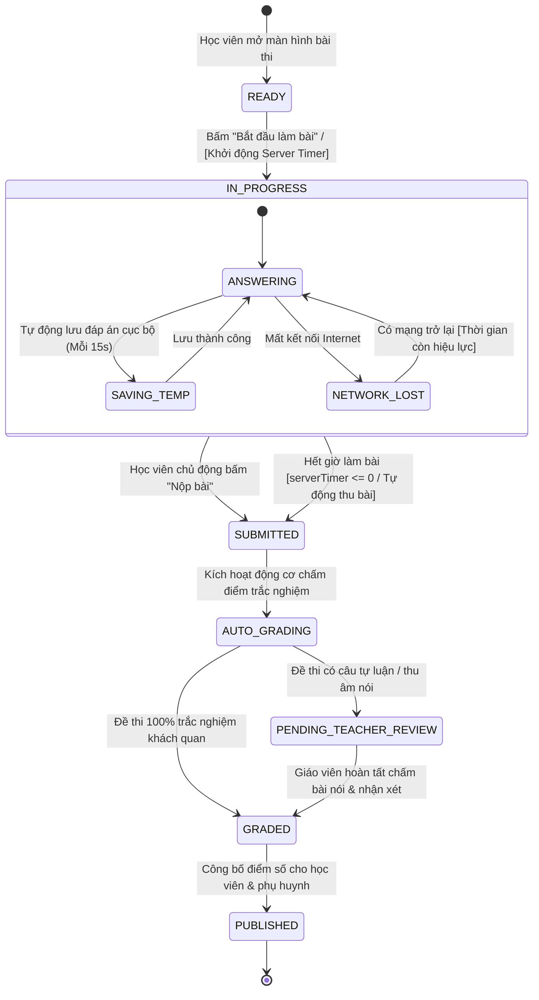

# 🏛️ BÀI TẬP TRÊN LỚP SỐ 3: THIẾT KẾ CÁC KHUNG NHÌN KIẾN TRÚC
## TASK #1: THIẾT KẾ VIEW KIẾN TRÚC LOGIC (LOGICAL VIEWS)

> **Tên đề tài:** Hệ thống Quản lý Học tập (LMS) Trung tâm Ngoại ngữ  
> **Môn học:** Kiến trúc Phần mềm / Phân tích Thiết kế Hệ thống  
> **Thời gian nộp:** 23h59 ngày 23/10/2026  
> **Chuẩn thiết kế:** Unified Modeling Language (UML 2.5)  
> **Tài liệu tham khảo chính:** Slide bài giảng "Các góc nhìn Kiến trúc (Architectural Views) - 4+1 View Model"  

---

## 1. TỔNG QUAN VỀ LOGICAL VIEW TRONG HỆ THỐNG LMS

### 1.1. Mục đích và phạm vi của Logical View
Theo mô hình 4+1 View của Philippe Kruchten và nội dung bài giảng (Slide 6-13, Slide 39):
- **Logical View (Khung nhìn Logic)** tập trung trả lời câu hỏi cốt lõi: *"Hệ thống cung cấp những chức năng và dịch vụ gì cho người dùng cuối?"*.
- Khung nhìn này mô hình hóa cấu trúc tĩnh của hệ thống miền vấn đề (Problem Domain), bao gồm các lớp (Classes), đối tượng (Objects), ranh giới trách nhiệm, và mạng lưới quan hệ giữa chúng.
- **Nền tảng cho các view khác:** Logical View là điểm xuất phát trực tiếp; từ các lớp trong Logical View, ta sẽ ánh xạ sang các luồng điều khiển trong **Process View** (Task #2), sang các tệp mã nguồn và thư viện trong **Implementation View** (Task #3), và sang các nút tính toán vật lý trong **Deployment View** (Task #4).

### 1.2. Bốn nguyên lý thiết kế áp dụng trong Logical View của LMS (Slide 9)
1. **Abstraction (Tính trừu tượng hóa):**
   - Chỉ giữ lại các thuộc tính và hành vi thực sự cần thiết cho bài toán quản trị học vụ ngoại ngữ.
   - *Ví dụ:* Lớp `Course` chỉ quan tâm đến `code`, `title`, `tuitionFee`, `totalHours`, `syllabus`; không quan tâm các chi tiết phi nghiệp vụ.
2. **Encapsulation (Tính đóng gói):**
   - Che giấu toàn bộ dữ liệu nội tại và chi tiết hiện thực phía sau các phương thức công khai (Public Interface).
   - *Ví dụ:* Điểm thi `ExamAttempt.totalScore` hay trạng thái tài khoản `User.status` được bảo vệ (`private/protected`), chỉ được sửa đổi thông qua các nghiệp vụ tính điểm hoặc phê duyệt (`calculateScore()`, `activateAccount()`).
3. **Layering (Kiến trúc phân tầng):**
   - Hệ thống được tổ chức thành các tầng có trách nhiệm phân định rõ ràng (Slide 10):
     - **Presentation Layer (Tầng Giao diện / Điều khiển):** Tiếp nhận tương tác người dùng, xử lý DTO, bắt lỗi HTTP.
     - **Business Logic Layer (Tầng Nghiệp vụ / Dịch vụ):** Chứa toàn bộ quy tắc nghiệp vụ (xếp lịch không trùng phòng, tính điểm trắc nghiệm, tạo công nợ).
     - **Data Access Layer (Tầng Truy xuất Dữ liệu):** Trừu tượng hóa việc lưu trữ với cơ sở dữ liệu quan hệ PostgreSQL qua Prisma ORM.
   - Quy tắc bất biến: Tầng trên chỉ gọi tầng ngay bên dưới.
4. **High Cohesion & Low Coupling (Độ gắn kết cao, độ phụ thuộc thấp):**
   - Mỗi lớp thực hiện một trách nhiệm duy nhất (Single Responsibility Principle).
   - Các gói chức năng (Học vụ, Điểm danh, Thi online, Học phí) độc lập với nhau, giao tiếp thông qua Interface rõ ràng.

---

## 2. BIỂU ĐỒ LỚP TỔNG THỂ (OVERALL CLASS DIAGRAM)

### 2.1. Bản vẽ biểu đồ lớp UML tổng thể
Biểu đồ lớp dưới đây được thiết kế theo chuẩn UML 2.5, phản ánh đầy đủ các quan hệ cấu trúc căn bản được nhấn mạnh trong bài giảng (Slide 8, Slide 13):
- **Generalization (Kế thừa kế thừa (Generalization)):** Lớp cha trừu tượng `BaseEntity` và `User` mở rộng thành `StudentProfile`, `TeacherProfile`.
- **Composition (Hợp thành $\blacklozenge$):** Quan hệ "Có" chặt chẽ, cùng vòng đời. Khi lớp cha bị hủy, lớp con bị hủy theo:
  - `Class` hợp thành (Composition) `Session` (Lớp học sở hữu các buổi học).
  - `Exam` hợp thành (Composition) `ExamQuestion` (Đề thi sở hữu các câu hỏi).
  - `Invoice` hợp thành (Composition) `PaymentReceipt` (Hóa đơn sở hữu biên lai thanh toán).
- **Aggregation (Kết tập $\lozenge$):** Quan hệ "Có" lỏng lẻo, bộ phận tồn tại độc lập khi bỏ cái lớn:
  - `Branch` kết tập (Aggregation) `Room` (Chi nhánh có các phòng học; nếu đóng chi nhánh, phòng học có thể cơ cấu lại).
  - `Course` kết tập (Aggregation) `Class` (Khóa học mở các lớp; hủy một lớp học thì giáo trình khóa học vẫn tồn tại).
  - `Class` kết tập (Aggregation) `Enrollment` (Lớp học chứa danh sách ghi danh).
- **Association (Liên kết liên kết (Association)):** Quan hệ cộng tác làm việc giữa hai thực thể độc lập:
  - `StudentProfile` $1  ---  *$ `Enrollment` (Học viên tham gia nhiều lớp).
  - `TeacherProfile` $1  ---  *$ `Class` (Giáo viên phụ trách lớp).
  - `StudentProfile` $1  ---  *$ `ExamAttempt` (Học viên tham gia các lượt thi).
  - `ParentProfile` $*  ---  *$ `StudentProfile` (Phụ huynh liên kết với con em).

---

### 2.2. Biểu đồ phân tầng Package trong Logical View (Package Architecture)
Tuân thủ nguyên lý phân tầng (Layered Architecture - Slide 10, Slide 11):

---

## 3. NỘI DUNG GIỚI THIỆU CHI TIẾT TỪNG LỚP TRONG HỆ THỐNG

| STT | Tên Lớp (Class Name) | Tầng / Package | Trách nhiệm chính (Single Responsibility) | Các thuộc tính & Phương thức trọng yếu |
|:---:|:---|:---|:---|:---|
| **1** | `BaseEntity` | Domain Core | Lớp cha trừu tượng cung cấp các định danh cơ sở và dấu thời gian cho mọi thực thể nghiệp vụ. | - `id: String` - `createdAt, updatedAt: DateTime` + `delete(): void` |
| **2** | `User` | Domain / Auth | Quản lý định danh tài khoản tập trung, cơ chế bảo mật xác thực, phân quyền RBAC và trạng thái kích hoạt lần đầu. | - `username, email, phone: String` - `passwordHash: String` - `role: UserRole` - `status: UserStatus` + `verifyPassword()`, `changePassword()` |
| **3** | `StudentProfile` | Domain / Academic | Kế thừa từ `User`, lưu trữ thông tin học vụ của học viên, hồ sơ cá nhân và quản lý lịch sử tham gia khóa học. | - `studentCode: String` - `dateOfBirth: DateTime` - `gender: Gender` + `getEnrolledClasses()`, `getTuitionDebt()` |
| **4** | `TeacherProfile` | Domain / Academic | Kế thừa từ `User`, quản lý hồ sơ giảng viên, trình độ chuyên môn ngoại ngữ, khung giờ dạy và thù lao tiết dạy. | - `teacherCode: String` - `specialization: String` - `hourlyRate: Decimal` + `getAssignedClasses()` |
| **5** | `ParentProfile` | Domain / Academic | Kế thừa từ `User`, biểu diễn mối quan hệ phụ huynh theo dõi tiến độ, kết quả học tập và nhận thông báo học vụ của con em. | - `parentCode: String` - `relationship: String` + `getChildren(): List<StudentProfile>` |
| **6** | `Branch` | Domain / Organization | Đại diện cho các chi nhánh/cơ sở đào tạo của trung tâm ngoại ngữ, quản lý hạ tầng phòng học và nhân sự chi nhánh. | - `code, name, address, hotline: String` + `addRoom(room: Room): void` |
| **7** | `Room` | Domain / Logistics | Đại diện cho phòng học vật lý tại chi nhánh, quản lý sức chứa tối đa và kiểm tra trạng thái khả dụng theo khung giờ. | - `roomNumber: String` - `capacity: Int` + `isAvailable(timeSlot): Boolean` |
| **8** | `Course` | Domain / Academic | Quản lý khung chương trình đào tạo tổng quát (IELTS, TOEIC, Giao tiếp), số giờ đào tạo chuẩn và mức học phí cơ sở. | - `code, title: String` - `basePrice: Decimal` - `totalHours: Int` + `createClass(term): Class` |
| **9** | `Class` | Domain / Academic | Lớp học cụ thể được mở theo kỳ. Điều phối giảng viên, phòng học, lịch học, ngưỡng sĩ số tối thiểu/tối đa và các buổi học. | - `classCode, name: String` - `minStudents, maxStudents: Int` - `status: ClassStatus` + `generateSessions()`, `checkConflict()`, `enrollStudent()` |
| **10** | `Session` | Domain / Academic | Đại diện cho một buổi học cụ thể trên thời khóa biểu. Lưu vết ngày học, ca học, giảng viên, phòng học và kết quả điểm danh. | - `sessionNumber: Int` - `date, startTime, endTime` - `status: SessionStatus` + `markAttendance(records): void` |
| **11** | `Enrollment` | Domain / Academic | Thực thể trung gian quản lý mối quan hệ ghi danh giữa học viên và lớp học, theo dõi trạng thái bảo lưu/chuyển lớp và điểm tổng kết. | - `enrolledAt: DateTime` - `status: EnrollmentStatus` - `finalGrade: Decimal` + `updateStatus(newStatus): void` |
| **12** | `AttendanceRecord` | Domain / Attendance | Lưu vết chuyên cần chi tiết của từng học viên trong từng buổi học (Có mặt, Đi trễ, Vắng có phép, Vắng không phép). | - `status: AttendanceStatus` - `note: String` - `markedAt: DateTime` + `updateStatus(status): void` |
| **13** | `Assignment` | Domain / Assessment | Quản lý bài tập về nhà do giáo viên giao cho lớp, thời hạn chót nộp bài, tiêu chí điểm và cờ cho phép nộp audio bài nói. | - `title, description: String` - `deadline: DateTime` - `allowAudioSubmission: Boolean` + `isPastDeadline(): Boolean` |
| **14** | `AssignmentSubmission` | Domain / Assessment | Bài làm nộp của học viên, lưu trữ văn bản trả lời, đường dẫn file tài liệu hoặc file âm thanh ghi âm giọng nói luyện phát âm. | - `textContent, fileAttachmentUrl: String` - `audioRecordingUrl: String` - `score: Decimal` + `gradeSubmission(score, feedback): void` |
| **15** | `Exam` | Domain / Assessment | Quản lý bài thi / bài kiểm tra định kỳ (Placement Test, Midterm, Final Test) với thời lượng quy định và bộ đếm giờ server. | - `title, durationMinutes` - `totalScore: Decimal` - `status: ExamStatus` + `publishExam()`, `startAttempt(student)` |
| **16** | `ExamQuestion` | Domain / Assessment | Câu hỏi thành phần trong đề thi (Trắc nghiệm 1 đáp án, Nhiều đáp án, Điền khuyết từ, Nối câu, Nghe đoạn hội thoại). | - `orderNumber: Int` - `type: QuestionType` - `promptText, optionsJson, correctAnswer` + `validateAnswer(userAns): Boolean` |
| **17** | `ExamAttempt` | Domain / Assessment | Phiên làm bài thi trực tuyến của một học viên, quản lý thời điểm bắt đầu, tự động nộp bài khi hết giờ và tính điểm trắc nghiệm. | - `startedAt, submittedAt: DateTime` - `earnedScore: Decimal` - `status: AttemptStatus` + `autoGradeObjective()`, `finalizeScore()` |
| **18** | `Invoice` | Domain / Finance | Quản lý nghĩa vụ tài chính học phí của học viên khi vào lớp, hạn nộp học phí, các đợt giảm trừ học bổng và trạng thái thanh toán. | - `invoiceCode: String` - `amount: Decimal` - `status: InvoiceStatus` + `createPaymentTransaction()`, `markAsPaid()` |
| **19** | `PaymentReceipt` | Domain / Finance | Bản ghi giao dịch thanh toán thành công, ghi nhận mã đối soát giao dịch ngân hàng/VNPay hoặc phiếu thu tiền mặt tại quầy. | - `transactionRef: String` - `paidAmount: Decimal` - `paymentMethod: PaymentMethod` - `gatewayResponse: String` |
| **20** | `ClassService` | Business Service | Dịch vụ điều phối nghiệp vụ xếp lớp, thuật toán tự động sinh danh sách buổi học và thuật toán kiểm tra chống trùng lịch. | + `createClassWithSessions()` + `validateNoScheduleConflict()` + `enrollStudentWithCapacityCheck()` |
| **21** | `AttendanceService` | Business Service | Dịch vụ xử lý điểm danh chuyên cần, kích hoạt sự kiện phát thông báo thời gian thực đến phụ huynh khi học viên vắng mặt. | + `submitSessionAttendance()` + `emitAttendanceAlertEvent()` + `processMakeupRequest()` |
| **22** | `ExamService` | Business Service | Dịch vụ tổ chức thi trực tuyến, quản lý đồng hồ đếm ngược phía máy chủ chống gian lận và tự động chấm điểm trắc nghiệm tức thì. | + `startExamSession()` + `submitExamAnswers()` + `autoGradeAndPublish()` |
| **23** | `FinanceService` | Business Service | Dịch vụ quản lý dòng tiền học phí, khởi tạo URL thanh toán VNPay có chữ ký bảo mật SHA-512 và xác thực Webhook đối soát IPN. | + `generateInvoice()` + `createVNPayPaymentUrl()` + `handlePaymentCallbackIPN()` |

---

## 4. BIỂU ĐỒ TRẠNG THÁI (STATE MACHINE DIAGRAM)

Trong hệ thống LMS Trung tâm Ngoại ngữ, hai thực thể có vòng đời nghiệp vụ phức tạp và mang tính cốt lõi nhất là:
1. **Lớp học (`Class`)**: Đại diện cho chu trình vận hành học vụ từ khâu lập kế hoạch đến kết thúc khóa học.
2. **Lượt thi trực tuyến (`ExamAttempt`)**: Đại diện cho chu trình tương tác thời gian thực của học viên khi làm bài kiểm tra.

Dưới đây là đặc tả chi tiết Biểu đồ trạng thái UML cho cả 2 thực thể theo đúng chuẩn UML 2.5 (Slide 8).

### 4.1. Biểu đồ trạng thái Vòng đời Lớp học (Class Lifecycle State Machine)

#### Giới thiệu chi tiết từng trạng thái của Lớp học:

1. **Trạng thái `PLANNING` (Lên kế hoạch):**
   - **Mục đích:** Lớp học vừa được nhân viên học vụ tạo dự thảo trong hệ thống.
   - **Đặc điểm:** Chưa công khai lên cổng thông tin; đang trong quá trình thương thảo lịch dạy với giảng viên và phân bổ phòng học phù hợp.
   - **Hành động (Entry Action):** Khởi tạo mã lớp học (`classCode`), kiểm tra khung giờ trống của phòng học (`Room.isAvailable`).
   - **Sự kiện chuyển tiếp (Trigger):** `approveClassPlanning()` kèm điều kiện guard `[hasTeacher && hasRoom]` -> chuyển sang `OPEN_FOR_ENROLLMENT`.

2. **Trạng thái `OPEN_FOR_ENROLLMENT` (Mở tuyển sinh / Ghi danh):**
   - **Mục đích:** Lớp học được công khai trên ứng dụng Mobile và Web Portal để tư vấn viên xếp học viên vào lớp và học viên đăng ký giữ chỗ.
   - **Đặc điểm:** Tiếp nhận các bản ghi `Enrollment`. Giới hạn sĩ số được kiểm soát chặt chẽ bởi ràng buộc `minStudents` và `maxStudents`.
   - **Sự kiện nội tại (Internal Transition):** Mỗi lần học viên đóng học phí, sĩ số tăng lên 1 đơn vị.
   - **Rẽ nhánh (Branching):**
     - Nếu đến ngày chốt sổ mà `currentEnrollment < minStudents` -> Chuyển sang `CANCELLED` (Hủy lớp, hoàn phí/chuyển lớp khác).
     - Nếu đến ngày `startDate` và `currentEnrollment >= minStudents` -> Chuyển sang `IN_PROGRESS`.

3. **Trạng thái `IN_PROGRESS` (Đang diễn ra đào tạo):**
   - **Mục đích:** Lớp học chính thức bước vào chu trình giảng dạy thực tế.
   - **Trạng thái con (Sub-states):**
     - `TEACHING_SESSION`: Diễn ra các buổi học theo thời khóa biểu.
     - `ATTENDANCE_MARKED`: Giáo viên thực hiện điểm danh từng buổi; hệ thống phát sinh thông báo vắng học đến phụ huynh.
     - `MIDTERM_EXAM`: Tổ chức thi kiểm tra giữa khóa.
   - **Sự kiện kết thúc:** Buổi học cuối cùng kết thúc, giảng viên nộp bảng điểm tổng kết -> chuyển sang `COMPLETED`.

4. **Trạng thái `COMPLETED` (Hoàn thành khóa học):**
   - **Mục đích:** Lớp học đã hoàn tất toàn bộ chương trình đào tạo theo giáo trình.
   - **Hành động (Entry Action):** Tự động tính toán điểm chuyên cần và điểm thi cuối kỳ; xuất bảng tổng hợp chứng chỉ cho học viên; đóng chức năng điểm danh và giao bài tập mới.
   - **Sự kiện tiếp theo:** Sau thời gian lưu trữ quy định (ví dụ 90 ngày) -> chuyển sang `ARCHIVED`.

5. **Trạng thái `CANCELLED` (Đã hủy):**
   - **Mục đích:** Xử lý tình huống lớp không đủ sĩ số tối thiểu hoặc gặp sự cố bất khả kháng.
   - **Hành động (Entry Action):** Giải phóng phòng học và lịch dạy của giáo viên; kích hoạt quy trình hoàn tiền (`refundInvoice`) hoặc điều chuyển học viên sang lớp học tương đương khác.

6. **Trạng thái `ARCHIVED` (Lưu trữ):**
   - **Mục đích:** Dữ liệu lớp học được đóng băng và chuyển sang chế độ chỉ đọc (Read-only) nhằm phục vụ công tác thanh tra học vụ và thống kê báo cáo lịch sử trung tâm.

---

### 4.2. Biểu đồ trạng thái Vòng đời Bài thi trực tuyến (Exam Attempt State Machine)

#### Giới thiệu chi tiết từng trạng thái của Phiên làm bài thi (`ExamAttempt`):

1. **Trạng thái `READY` (Sẵn sàng):**
   - **Ý nghĩa:** Học viên đã vào phòng thi trực tuyến trên ứng dụng di động, màn hình hiển thị quy chế phòng thi, số lượng câu hỏi và tổng thời gian làm bài.
   - **Entry Action:** Kiểm tra tính hợp lệ của token học viên; tải trước (pre-fetch) đề thi đã được mã hóa về bộ nhớ máy khách.

2. **Trạng thái `IN_PROGRESS` (Đang làm bài thi):**
   - **Ý nghĩa:** Đồng hồ đếm ngược phía máy chủ (Server-side Countdown) chính thức kích hoạt. Học viên thao tác chọn đáp án, thu âm câu trả lời phát âm hoặc nhập văn bản.
   - **Hành vi an toàn (Fault Tolerance):**
     - Trạng thái con `SAVING_TEMP`: Tự động đồng bộ đáp án học viên vừa chọn về Redis Cache mỗi 15 giây để chống mất dữ liệu khi rớt mạng đột ngột.
     - Xử lý mất mạng (`NETWORK_LOST`): Cho phép học viên tiếp tục làm bài offline trên bộ nhớ tạm; khi có kết nối trở lại sẽ đồng bộ dữ liệu nếu thời gian thi trên server vẫn còn hiệu lực.
   - **Điều kiện thoát:**
     - *Thoát chủ động:* Học viên bấm xác nhận nộp bài.
     - *Thoát bắt buộc:* Đồng hồ server về 0 -> Tự động ngắt quyền thao tác và thu bài cưỡng chế.

3. **Trạng thái `SUBMITTED` (Đã nộp bài):**
   - **Ý nghĩa:** Toàn bộ đáp án của học viên đã được ghi nhận an toàn vào cơ sở dữ liệu PostgreSQL. Quyền chỉnh sửa đáp án bị khóa hoàn toàn.
   - **Hành động:** Kích hoạt sự kiện nghiệp vụ `ExamSubmittedEvent`.

4. **Trạng thái `AUTO_GRADING` (Tự động chấm trắc nghiệm):**
   - **Ý nghĩa:** Động cơ máy tính (Grading Engine) so sánh các câu hỏi trắc nghiệm (Multiple Choice, True/False, Điền khuyết) với bảng đáp án chuẩn.
   - **Thời gian xử lý:** Dưới 1 giây.
   - **Rẽ nhánh:**
     - Nếu đề thi có câu hỏi nói (ghi âm Speaking) hoặc viết luận (Writing) -> chuyển sang `PENDING_TEACHER_REVIEW`.
     - Nếu đề thi thuần trắc nghiệm -> chuyển thẳng sang `GRADED`.

5. **Trạng thái `PENDING_TEACHER_REVIEW` (Chờ giáo viên chấm điểm thủ công):**
   - **Ý nghĩa:** Bài thi được đưa vào hàng đợi chấm của giáo viên phụ trách lớp. Giáo viên nghe các file ghi âm phát âm, đọc bài luận, cho điểm theo thang tiêu chí (Rubric) và ghi chú nhận xét phát âm.

6. **Trạng thái `GRADED` (Đã hoàn tất chấm điểm):**
   - **Ý nghĩa:** Điểm tổng hợp của toàn bộ các phần thi đã được chốt và ký số/xác thực bởi giáo viên.

7. **Trạng thái `PUBLISHED` (Đã công bố điểm):**
   - **Ý nghĩa:** Điểm thi chính thức xuất hiện trên màn hình học tập của Học viên và gửi thông báo Notification đến ứng dụng của Phụ huynh; cập nhật điểm vào sổ điểm tổng kết của lớp học.

---

## 5. KẾT LUẬN TASK #1
Khung nhìn kiến trúc Logic (Logical View) đã đặc tả toàn diện:
1. Cấu trúc tĩnh của hệ thống LMS Trung tâm Ngoại ngữ với 23 lớp nghiệp vụ phân chia theo đúng nguyên lý phân tầng và độ gắn kết cao.
2. Bản vẽ biểu đồ lớp tổng thể chuẩn UML thể hiện chính xác 4 loại quan hệ: Generalization, Composition, Aggregation, Association và Dependency.
3. Biểu đồ trạng thái chuẩn UML cho 2 vòng đời nghiệp vụ nòng cốt: Vòng đời Lớp học (`Class`) và Vòng đời Phiên làm bài thi trực tuyến (`ExamAttempt`), kèm đặc tả chi tiết về triggers, guards, actions của từng trạng thái.
4. Tài liệu này đóng vai trò bản thiết kế nền tảng để xây dựng khung nhìn tiến trình xử lý tương tranh tại **Task #2**.
