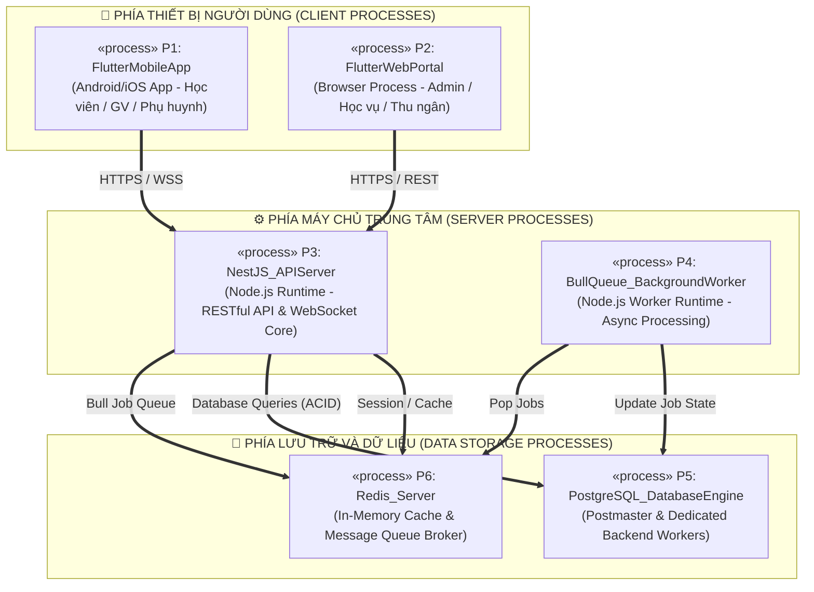
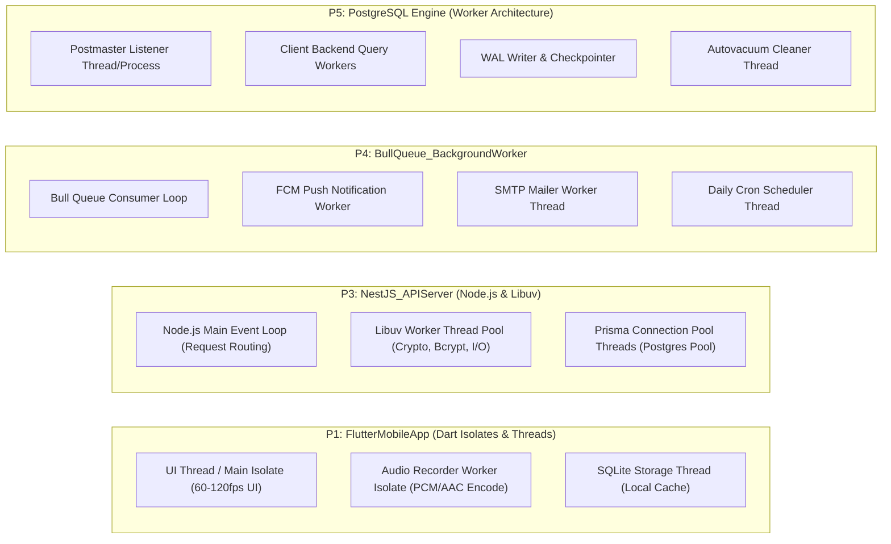
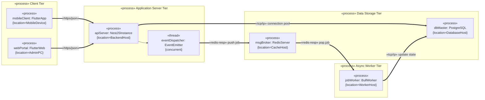
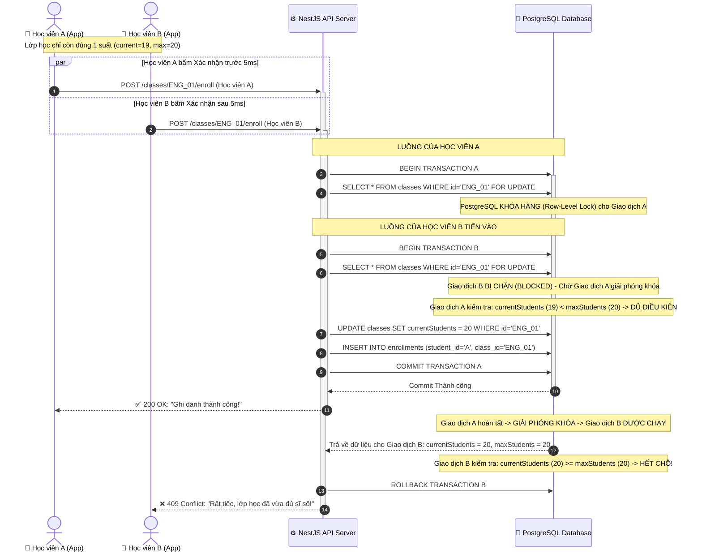

# 🏛️ BÀI TẬP TRÊN LỚP SỐ 3: THIẾT KẾ CÁC KHUNG NHÌN KIẾN TRÚC
## TASK #2: THIẾT KẾ VIEW KIẾN TRÚC TIẾN TRÌNH (PROCESS VIEWS)

> **Tên đề tài:** Hệ thống Quản lý Học tập (LMS) Trung tâm Ngoại ngữ  
> **Môn học:** Kiến trúc Phần mềm / Phân tích Thiết kế Hệ thống  
> **Thời gian nộp:** 23h59 ngày 23/10/2026  
> **Chuẩn thiết kế:** Unified Modeling Language (UML 2.5)  
> **Tài liệu tham khảo chính:** Slide bài giảng "Các góc nhìn Kiến trúc (Architectural Views) - Phần 03 & Slide 40"  

---

## 1. TỔNG QUAN VỀ PROCESS VIEW TRONG HỆ THỐNG LMS

### 1.1. Mục đích và phạm vi của Process View
Theo nội dung bài giảng (Slide 14-22, Slide 40):
- **Process View (Khung nhìn Tiến trình)** tập trung trả lời câu hỏi cốt lõi: *"Hệ thống thực thi lúc chạy (runtime) như thế nào? Xử lý tương tranh, đa luồng và đồng bộ ra sao?"*.
- Khung nhìn này xem xét hệ thống dưới góc độ các thực thể đang hoạt động: các **tiến trình (Processes)**, các **luồng (Threads)**, các **đối tượng chủ động (Active Objects)**, và cơ chế giao tiếp liên tiến trình (IPC - Inter-Process Communication).
- Khung nhìn tiến trình giải quyết các bài toán phi chức năng then chốt:
  - Khả năng chịu tải đồng thời (Concurrency & Throughput).
  - Đảm bảo tính toàn vẹn dữ liệu, triệt tiêu xung đột tranh chấp tài nguyên (Race Conditions, Deadlocks).
  - Tối ưu hóa hiệu năng và độ phản hồi của giao diện người dùng.

### 1.2. Phân biệt Process và Thread trong kiến trúc (Slide 16)
- **Process (Tiến trình):** Là một luồng điều khiển nặng (heavyweight unit), sở hữu không gian bộ nhớ địa chỉ ảo hoàn toàn độc lập được hệ điều hành bảo vệ. Khi một process gặp sự cố sập (crash), nó không gây ảnh hưởng trực tiếp đến bộ nhớ của process khác. Giao tiếp giữa các process phải thông qua mạng (Sockets, HTTP, WSS) hoặc IPC.
- **Thread (Luồng):** Là một luồng thực thi nhẹ (lightweight unit) bên trong một tiến trình. Các thread chia sẻ chung không gian bộ nhớ và tài nguyên của process cha, cho phép trao đổi dữ liệu tốc độ cao nhưng đòi hỏi cơ chế đồng bộ hóa nghiêm ngặt để tránh lỗi ghi đè đồng thời.

### 1.3. Khái niệm Active Object và Passive Object (Slide 17)
- **Passive Object (Đối tượng bị động):** Là các đối tượng thông thường (class thông thường trong Logical View), không có luồng thực thi riêng. Nó chỉ thực thi phương thức khi được một luồng khác gọi đến.
- **Active Object (Đối tượng chủ động):** Là đối tượng sở hữu luồng điều khiển độc lập của riêng mình (`<<process>>` hoặc `<<thread>>`), có khả năng tự phát động hành động hoặc xử lý thông điệp từ hàng đợi độc lập với bên gọi.

---

## 2. XÁC ĐỊNH CÁC PROCESS TRONG DỰ ÁN LMS

Hệ thống LMS Trung tâm Ngoại ngữ được cấu trúc từ **6 tiến trình cấp hệ điều hành (OS Processes)** chạy trên các môi trường phân tán:



### Bảng đặc tả chi tiết 6 Process chính:

| Mã Process | Tên Tiến trình | Không gian thực thi | Vai trò & Trách nhiệm runtime trong hệ thống |
|:---:|:---|:---|:---|
| **P1** | `FlutterMobileApp` | Thiết bị di động (Android / iOS) | Ứng dụng client dành cho Học viên, Phụ huynh và Giáo viên; quản lý vòng đời ứng dụng trên điện thoại, render giao diện, ghi âm bài nói phát âm và nhận push notification. |
| **P2** | `FlutterWebPortal` | Trình duyệt Web (Chrome, Edge, Safari) | Ứng dụng web portal dành cho Admin, Nhân viên học vụ và Thu ngân; quản lý xếp lớp, điều phối phòng học, đối soát học phí và xuất báo cáo. |
| **P3** | `NestJS_APIServer` | Máy chủ Node.js Backend | Tiến trình máy chủ trung tâm; tiếp nhận mọi HTTP/REST request từ client, thực thi xác thực JWT, phân quyền RBAC, kiểm tra trùng lịch và tính điểm thi. |
| **P4** | `BullQueue_BackgroundWorker` | Máy chủ Node.js Worker | Tiến trình chạy ngầm chuyên biệt; lắng nghe hàng đợi Bull Queue từ Redis để thực thi các tác vụ nặng: bắn push notification qua FCM, gửi email, quét cron job. |
| **P5** | `PostgreSQL_DatabaseEngine` | Máy chủ Cơ sở dữ liệu | Hệ quản trị cơ sở dữ liệu quan hệ PostgreSQL; quản lý dữ liệu bền vững, thực thi các truy vấn ACID, khóa giao dịch chống tranh chấp dữ liệu. |
| **P6** | `Redis_Server` | Máy chủ Bộ nhớ đệm | Máy chủ In-memory tốc độ cực cao; quản lý phiên làm việc (Session Store), cache danh mục dữ liệu và đóng vai trò Message Broker cho hàng đợi công việc. |

---

## 3. CÁC THREAD BÊN TRONG TỪNG PROCESS

Để đảm bảo hiệu năng và tính ổn định, mỗi tiến trình trong hệ thống LMS đều tận dụng kiến trúc đa luồng chuyên biệt:



### 3.1. Phân rã luồng trong `P1: FlutterMobileApp`
1. **UI Thread / Main Isolate (Luồng giao diện chính):**
   - Chịu trách nhiệm thực thi mã nguồn ứng dụng Dart, lắng nghe sự kiện chạm màn hình (touch events), tính toán layout và chỉ thị GPU render khung hình ở tần số 60fps hoặc 120fps.
   - Luồng này tuyệt đối không thực hiện các tác vụ tính toán nặng để tránh gây hiện tượng "giật/đứng hình" (UI Jank/Freeze).
2. **Audio Recorder Worker Isolate (Luồng ghi âm & nén âm thanh):**
   - Là một Dart Isolate độc lập sở hữu bộ nhớ riêng biệt.
   - Khi học viên làm bài tập phát âm hoặc nộp bài kiểm tra kỹ năng nói (Speaking), luồng này tiếp nhận dữ liệu sóng âm raw từ microphone thiết bị, thực hiện nén chuẩn AAC/M4A và tính toán dung lượng trước khi kích hoạt tải lên Cloud Storage.
3. **SQLite Local Storage Thread (Luồng cơ sở dữ liệu ngoại tuyến):**
   - Thực thi các thao tác đọc/ghi bất đồng bộ xuống cơ sở dữ liệu cục bộ SQLite (`sqflite`), lưu tạm đáp án bài thi khi rớt mạng và lưu cache thời khóa biểu học viên.

### 3.2. Phân rã luồng trong `P3: NestJS_APIServer`
1. **Node.js Main Event Loop Thread (Luồng vòng lặp sự kiện chính):**
   - Vận hành theo mô hình Non-blocking I/O đơn luồng; tiếp nhận hàng nghìn kết nối HTTP song song, điều phối request qua các Guard, Pipe, Interceptor đến đúng Controller và Service.
2. **Libuv Worker Thread Pool (Nhóm luồng công nhân Libuv - Mặc định 4 threads):**
   - Xử lý các tác vụ CPU-intensive bị chặn (blocking tasks) của Node.js:
     - Băm mật khẩu học viên với thuật toán `bcrypt` (salt rounds = 12).
     - Xác thực chữ ký mã hóa JWT và đối soát chữ ký SHA-512 của cổng VNPay.
     - Xử lý nén luồng tập tin (gzip/deflate).
3. **Prisma Connection Pool Threads (Nhóm luồng kết nối cơ sở dữ liệu):**
   - Quản lý đồng thời tập hợp các kết nối mạng TCP socket đến PostgreSQL (Connection Pooling), tái sử dụng kết nối nhằm giảm thiểu chi phí bắt tay ba bước (3-way handshake).

### 3.3. Phân rã luồng trong `P4: BullQueue_BackgroundWorker`
1. **Queue Dispatcher Thread:** Liên tục thăm dò (polling/blocking pop `BRPOPLPUSH`) các job từ Redis server.
2. **FCM Push Notification Worker Thread:** Kết nối song song đến máy chủ Google FCM để gửi thông báo điểm danh, nhắc lịch học tức thì tới điện thoại phụ huynh.
3. **SMTP Mailer Worker Thread:** Thiết lập kết nối TLS với máy chủ Google SMTP để gửi email kích hoạt tài khoản và hóa đơn học phí dạng hàng loạt mà không ảnh hưởng đến API chính.
4. **Scheduled Cron Thread:** Thực thi định kỳ lúc 00:00 hàng ngày để quét các bài tập sắp hết hạn trong 24 giờ và tự động khóa các lớp học đã hoàn thành.

### 3.4. Phân rã luồng trong `P5: PostgreSQL Database Engine`
1. **Postmaster Listener Process:** Lắng nghe trên cổng mặc định 5432, cấp phát và quản lý các tiến trình kết nối con.
2. **Backend Query Workers:** Mỗi kết nối từ NestJS được phục vụ bởi một worker riêng biệt, thực thi phân tích cú pháp SQL và truy vấn bảng dữ liệu.
3. **WAL (Write-Ahead Logging) Writer:** Ghi tuần tự các thay đổi dữ liệu vào nhật ký WAL trước khi cập nhật dữ liệu đĩa, đảm bảo nguyên lý bền vững (Durability) của ACID.
4. **Checkpointer & Background Writer:** Định kỳ đẩy các trang dữ liệu bẩn (dirty buffers) từ bộ nhớ RAM xuống đĩa cứng vật lý.
5. **Autovacuum Worker:** Tự động thu hồi không gian bộ nhớ của các bản ghi đã bị xóa (dead tuples) và cập nhật thống kê query planner.

### 3.5. Phân rã luồng trong `P6: Redis Server`
1. **Main Event Loop Thread (Mô hình Reactor):** Thực thi tuần tự toàn bộ các lệnh đọc/ghi bộ nhớ in-memory (GET, SET, LPUSH, RPOP, INCR) với độ trễ siêu nhỏ (< 1 miligiây).
2. **I/O Socket Threads (Multi-threaded I/O từ Redis 6+):** Đảm nhiệm việc đọc/ghi dữ liệu thô trên socket mạng từ hàng trăm client đồng thời, giải phóng gánh nặng cho luồng Event Loop chính.
3. **Background Bio Threads:** Chạy ngầm các tác vụ nặng: `bio_close_file` (đóng tệp), `bio_aof_fsync` (ghi dữ liệu xuống đĩa), `bio_lazy_free` (xóa cấu trúc dữ liệu khổng lồ).

---

## 4. BẢNG ÁNH XẠ LOGICAL CLASSES SANG PROCESSES (Theo Slide 40)

Bảng dưới đây mô hình hóa mối liên kết chặt chẽ giữa các lớp trong Logical View (Task #1) và các tiến trình trong Process View (Task #2):

| Nhóm Lớp trong Logical View | Tiến trình sở hữu (Assigned Process) | Ký hiệu Stereotype | Giao thức truyền thông liên tiến trình |
|:---|:---|:---:|:---|
| `LoginScreen`, `ExamScreen`, `AudioRecorderWidget`, `ClassBloc` | `P1: FlutterMobileApp` | `«process»` | Tương tác cục bộ trong bộ nhớ máy khách |
| `AdminDashboardScreen`, `ClassManagerScreen`, `InvoiceScreen` | `P2: FlutterWebPortal` | `«process»` | Web Browser DOM / JavaScript V8 Engine |
| `AuthController`, `ClassController`, `AttendanceController`, `ExamController`, `FinanceController` | `P3: NestJS_APIServer` | `«process»` | Nhận request từ P1/P2 qua `«https»` (REST/JSON) |
| `AuthService`, `ClassService`, `AttendanceService`, `ExamService`, `FinanceService` | `P3: NestJS_APIServer` | `«process»` | Thực thi nghiệp vụ đồng bộ bên trong Node.js Runtime |
| `NotificationJobConsumer`, `EmailJobConsumer`, `ReportWorker` | `P4: BullQueue_BackgroundWorker` | `«process»` | Lắng nghe hàng đợi từ P6 qua `«redis-resp»` |
| `PrismaClient`, `UserRepository`, `ClassRepository`, `ExamRepository`, `InvoiceRepository` | `P3: NestJS_APIServer` & `P5: PostgreSQL` | `«process»` | Truy vấn cơ sở dữ liệu qua `«tcp/ip»` (Port 5432) |
| `SessionCache`, `DistributedLock`, `BullJobQueue` | `P6: Redis_Server` | `«process»` | Giao tiếp bộ nhớ đệm qua `«tcp/ip»` (Port 6379) |

---

## 5. XÁC ĐỊNH VÀ GIẢI QUYẾT XUNG ĐỘT TÀI NGUYÊN (CONCURRENCY & CONFLICT RESOLUTION)

Theo bài giảng (Slide 18, 19, 20):
- **Giao tiếp đồng bộ (Synchronous / RPC):** Bên gọi gửi yêu cầu -> dừng chờ -> nhận kết quả (Gửi -> Chờ -> Nhận). Phù hợp với các thao tác đòi hỏi kết quả tức thì và tính nhất quán tuyệt đối.
- **Giao tiếp bất đồng bộ (Asynchronous / Message Passing):** Bên gọi gửi thông điệp vào hàng đợi -> lập tức tiếp tục công việc của mình mà không dừng chờ. Phù hợp với các tác vụ tốn thời gian, độ trễ mạng cao.
- **Ba cơ chế đồng bộ trên Operation (Slide 20):**
  - `Sequential`: Không an toàn đa luồng; bên gọi phải tự phối hợp.
  - `Guarded`: Đối tượng tự động tuần tự hóa các lời gọi; mỗi thời điểm chỉ duy nhất 1 thao tác được thực thi (cơ chế Lock / Mutex / Transaction).
  - `Concurrent`: Nhiều lời gọi thực thi đồng thời đúng ngữ nghĩa mà không làm sai dữ liệu (thao tác nguyên tử - Atomic).

Trong hệ thống LMS Trung tâm Ngoại ngữ, có **4 điểm xung đột tài nguyên/dữ liệu then chốt**:

---

### Xung đột 1: Tranh chấp giữ chỗ khi Lớp học chạm ngưỡng sĩ số tối đa (`max_students`)
* **Bối cảnh xung đột:** Một lớp học ngoại ngữ chỉ còn đúng 1 suất cuối cùng (`currentStudents = 19`, `maxStudents = 20`). Hai học viên A và B cùng lúc bấm xác nhận thanh toán/ghi danh trên điện thoại.
* **Nguy cơ:** Nếu hệ thống chỉ đọc dữ liệu thông thường (`SELECT`), cả hai luồng đều thấy còn 1 chỗ trống và đều ghi nhận thành công (`INSERT`) -> Sĩ số lớp bị đội lên 21 học viên (**Overbooking / Race Condition**).
* **Trả lời câu hỏi:** **ĐỒNG BỘ HAY BẤT ĐỒNG BỘ?**
  - **Lựa chọn:** **ĐỒNG BỘ (Synchronous RPC) kết hợp cơ chế GUARDED LOCK.**
  - **Lý do:** Thao tác đăng ký và trừ chỗ phải được phản hồi ngay lập tức cho học viên (Thành công hay Lớp đã đầy), không thể đưa vào hàng đợi xử lý sau vì liên quan đến việc thu tiền.
* **Giải pháp kỹ thuật chi tiết:**
  - Áp dụng kỹ thuật **Pessimistic Locking (Khóa bi quan)** bằng câu lệnh `SELECT ... FOR UPDATE` trong một Database Transaction của PostgreSQL (thông qua Prisma `$transaction`):
    ```sql
    BEGIN TRANSACTION;
    -- Khóa hàng ghi của lớp học, các giao dịch khác buộc phải chờ
    SELECT "id", "currentStudents", "maxStudents" 
    FROM "classes" 
    WHERE "id" = 'CLASS_01' 
    FOR UPDATE;

    -- Kiểm tra điều kiện Guard
    IF currentStudents < maxStudents THEN
        UPDATE "classes" SET "currentStudents" = "currentStudents" + 1 WHERE "id" = 'CLASS_01';
        INSERT INTO "enrollments" (...) VALUES (...);
        COMMIT;
        -- Trả về Thành công (200 OK)
    ELSE
        ROLLBACK;
        -- Ném ngoại lệ lỗi: 409 Conflict ("Lớp học đã đủ sĩ số")
    END IF;
    ```
  - Hoặc sử dụng **Distributed Mutex Lock với Redis Redlock** dựa trên key `lock:class:CLASS_01` với cơ chế `Guarded`.

---

### Xung đột 2: Xếp lịch buổi học (Session) - Trùng phòng học hoặc trùng giáo viên
* **Bối cảnh xung đột:** Hai nhân viên học vụ cùng lúc thao tác trên Web Portal để xếp lịch:
  - Nhân viên 1: Xếp Lớp A học tại Phòng P.102 vào Thứ 4 (18:00 - 20:00).
  - Nhân viên 2: Xếp Lớp B cũng học tại Phòng P.102 vào Thứ 4 (18:30 - 20:30).
* **Nguy cơ:** Trùng lặp vật lý phòng học hoặc trùng giáo viên đứng lớp tại cùng một khung giờ.
* **Trả lời câu hỏi:** **ĐỒNG BỘ HAY BẤT ĐỒNG BỘ?**
  - **Lựa chọn:** **ĐỒNG BỘ (Synchronous RPC) kết hợp RÀNG BUỘC TOÀN VẸN CSDL (Guarded Constraint).**
  - **Lý do:** Nhân viên học vụ cần nhận thông báo lỗi tức thì trên màn hình giao diện để chọn phòng học hoặc giáo viên khác.
* **Giải pháp kỹ thuật chi tiết:**
  - Sử dụng mức cô lập giao dịch **SERIALIZABLE Isolation Level** trong PostgreSQL.
  - Thiết lập **PostgreSQL Exclusion Constraint (Ràng buộc loại trừ khoảng thời gian)**:
    ```sql
    ALTER TABLE "sessions" 
    ADD CONSTRAINT "no_room_time_overlap" 
    EXCLUDE USING gist (
        room_id WITH =,
        tstzrange(start_time, end_time) WITH &&
    );
    ```
  - Khi có xung đột trùng giờ, cơ sở dữ liệu sẽ tự động từ chối giao dịch thứ hai và ném lỗi vi phạm ràng buộc; API bắt lỗi và trả về mã lỗi `400 Bad Request` kèm thông điệp chi tiết.

---

### Xung đột 3: Điểm danh buổi học và Gửi thông báo phụ huynh khi học viên vắng
* **Bối cảnh xung đột:** Giáo viên chủ nhiệm lớp 30 học viên thực hiện bấm nút "Hoàn thành điểm danh" trên ứng dụng di động. Trong lớp có 3 học viên vắng không phép. Hệ thống cần:
  1. Ghi nhận chuyên cần vào CSDL.
  2. Gửi Push Notification qua Google Firebase Cloud Messaging (FCM) đến điện thoại của từng phụ huynh có con vắng.
  3. Gửi email cảnh báo chuyên cần cho phụ huynh.
* **Nguy cơ nếu chọn sai:** Nếu thực hiện toàn bộ theo kiểu đồng bộ (Synchronous), giáo viên sẽ phải đứng chờ màn hình xoay vòng từ 3 đến 8 giây (do độ trễ kết nối mạng đến Google FCM và máy chủ SMTP) mới nhận được thông báo điểm danh thành công. Nếu mạng chập chờn, giáo viên có thể tưởng lỗi và bấm điểm danh nhiều lần gây trùng lặp bản ghi.
* **Trả lời câu hỏi:** **ĐỒNG BỘ HAY BẤT ĐỒNG BỘ?**
  - **Lựa chọn:** **MÔ HÌNH LAI (HYBRID MODEL): ĐỒNG BỘ TRONG GHI NHẬN HỌC VỤ + BẤT ĐỒNG BỘ TRONG TRUYỀN THÔNG BÁO.**
* **Giải pháp kỹ thuật chi tiết:**
  - **Bước 1 (Đồng bộ - Synchronous RPC):**
    - Ứng dụng di động gửi request `POST /api/v1/sessions/:id/attendance`.
    - Tiến trình `P3: NestJS_APIServer` lưu dữ liệu 30 bản ghi điểm danh vào `P5: PostgreSQL` trong một transaction ngắn.
    - Phát sinh sự kiện nội bộ `AttendanceMarkedEvent(absentStudentIds)`.
    - Trả ngay mã phản hồi `200 OK` cho ứng dụng di động trong vòng **dưới 50ms**. Ứng dụng hiển thị thông báo "Điểm danh hoàn tất", giáo viên chuyển sang giảng dạy bình thường.
  - **Bước 2 (Bất đồng bộ - Asynchronous Message Passing via Bull Queue):**
    - Bộ lắng nghe sự kiện (`EventListener`) đẩy 3 tác vụ thông báo vào hàng đợi `P6: Redis Bull Queue` (`notification_queue`).
    - Tiến trình công nhân `P4: BullQueue_BackgroundWorker` nhặt các job từ hàng đợi, lần lượt gọi API Google FCM và SMTP Server để gửi thông báo cho phụ huynh. Nếu gửi thất bại (ví dụ điện thoại phụ huynh tạm mất sóng), Bull Queue tự động thử lại (Retry with exponential backoff) mà không hề ảnh hưởng đến hệ thống chính.

---

### Xung đột 4: Webhook Thanh toán VNPay IPN vs Thu tiền mặt tại quầy
* **Bối cảnh xung đột:** Học viên đang ở trung tâm, vừa mở app quét mã QR VNPay để trả học phí, cùng lúc đó tư vấn viên tại quầy cũng bấm "Xác nhận thu tiền mặt" cho hóa đơn đó. Cả hai luồng dữ liệu tiến vào cập nhật trạng thái hóa đơn `Invoice` đồng thời.
* **Nguy cơ:** Hóa đơn bị ghi nhận hai lần, sai lệch sổ sách kế toán của trung tâm.
* **Trả lời câu hỏi:** **ĐỒNG BỘ HAY BẤT ĐỒNG BỘ?**
  - **Lựa chọn:** **ĐỒNG BỘ (Synchronous) kết hợp IDEMPOTENCY KEY & GUARDED REDIS LOCK.**
* **Giải pháp kỹ thuật chi tiết:**
  - Khi bắt đầu xử lý thanh toán cho hóa đơn có mã `INV_1001`, hệ thống tạo khóa phân tán trên Redis:
    ```typescript
    const lockAcquired = await redis.set(`lock:invoice:INV_1001`, 'locked', 'NX', 'EX', 5);
    if (!lockAcquired) {
        throw new ConflictException('Hóa đơn đang được xử lý thanh toán ở một kênh khác.');
    }
    ```
  - Luồng nào giành được lock trước sẽ kiểm tra: `if (invoice.status === 'PAID') throw Error`. Sau đó cập nhật hóa đơn sang `PAID` và ghi biên lai `PaymentReceipt`.
  - Luồng thứ hai đến sau sẽ bị từ chối, đảm bảo tính bất biến (Idempotent).

---

## 6. CÁC BIỂU ĐỒ UML TIẾN TRÌNH VÀ TƯƠNG TÁC (PROCESS VIEW DIAGRAMS)

### 6.1. Biểu đồ Active Class & Process View tổng thể (Slide 17, Slide 40)
Biểu diễn các Active Objects mang luồng điều khiển riêng (ký hiệu đường viền kép) và các giao thức kết nối liên tiến trình:



---

### 6.2. Biểu đồ Sequence Diagram: Luồng Điểm danh và Thông báo (Minh họa Đồng bộ vs Bất đồng bộ - Slide 18)

Biểu đồ dưới đây thể hiện rõ ràng ranh giới giữa **Luồng Đồng bộ (Sync RPC)** nhằm phản hồi tức thì cho Giáo viên và **Luồng Bất đồng bộ (Async Message Passing)** nhằm chuyển giao tác vụ nặng cho Background Worker:

```mermaid
sequenceDiagram
    autonumber
    actor GV as 👨‍🏫 Giáo viên (Mobile App)
    participant API as ⚙️ NestJS API Server (P3)
    participant DB as 💾 PostgreSQL (P5)
    participant REDIS as ⚡ Redis Bull Queue (P6)
    participant WORKER as 👷 Background Worker (P4)
    actor PH as 📱 Phụ huynh (Mobile)

    Note over GV, API: GIAI ĐOẠN 1: ĐỒNG BỘ (SYNCHRONOUS RPC) - DƯỚI 50ms
    GV->>+API: POST /sessions/101/attendance [HV_01: Có, HV_02: Vắng]
    API->>+DB: BEGIN TRANSACTION
    API->>DB: INSERT INTO attendance_records (status, student_id...)
    API->>DB: UPDATE sessions SET status = 'COMPLETED'
    DB-->>-API: COMMIT SUCCESS
    
    Note over API, REDIS: KÍCH HOẠT SỰ KIỆN NỀN (EVENT EMIT)
    API->)REDIS: LPUSH notification_queue {studentId: HV_02, type: 'ABSENT_ALERT'}
    
    API-->>-GV: ✅ 200 OK: "Điểm danh hoàn tất thành công!"
    Note over GV: Giáo viên nhận phản hồi ngay lập tức, tiếp tục dạy học

    Note over REDIS, PH: GIAI ĐOẠN 2: BẤT ĐỒNG BỘ (ASYNC MESSAGE PASSING)
    WORKER->>+REDIS: BRPOP notification_queue
    REDIS-->>-WORKER: Trả về Job: {studentId: HV_02}
    
    WORKER->>+DB: SELECT fcm_token, phone FROM parent_students WHERE student_id = HV_02
    DB-->>-WORKER: Trả về Parent Token (device_token_xyz)
    
    WORKER->>+PH: Gửi Push Notification qua Google FCM: "Học viên HV_02 vắng học hôm nay"
    PH-->>-WORKER: FCM Ack: 200 Delivered
    
    WORKER->>DB: INSERT INTO notifications_history (status: 'SENT')
    Note over WORKER: Tác vụ hoàn thành trong nền, độc lập hoàn toàn với giáo viên
```

---

### 6.3. Biểu đồ Sequence Diagram: Luồng xử lý tranh chấp giữ chỗ lớp học (Pessimistic Guarded Lock - Slide 19, 20)

Biểu đồ mô tả chi tiết cách giải quyết xung đột khi 2 học viên A và B cùng đăng ký suất cuối cùng của lớp học:



---

## 7. KẾT LUẬN TASK #2
Khung nhìn kiến trúc Tiến trình (Process View) đã hoàn thành xuất sắc các yêu cầu:
1. **Xác định đầy đủ 6 Process:** Tách biệt rõ ràng giữa Client, Server, Async Worker và Database Engines.
2. **Đặc tả chi tiết các Thread bên trong:** Làm rõ cấu trúc luồng của Dart Isolates trên di động, Node.js Event Loop & Libuv Worker Pool trên backend, và các background threads của PostgreSQL & Redis.
3. **Giải quyết triệt để 4 xung đột tài nguyên:** Đưa ra câu trả lời thuyết phục về tính **Đồng bộ** và **Bất đồng bộ**, áp dụng chuẩn xác 3 cơ chế đồng bộ `Sequential`, `Guarded`, `Concurrent` từ Slide bài giảng.
4. **Hệ thống sơ đồ tương tác UML chuẩn xác:** Thể hiện rõ nét luồng thực thi thời gian thực, độ ưu tiên phản hồi và cơ chế khóa bản ghi nguyên tử.
5. Tài liệu này là cơ sở trực tiếp để tổ chức mã nguồn và các tệp thành phần trong **Implementation View (Task #3)**.
