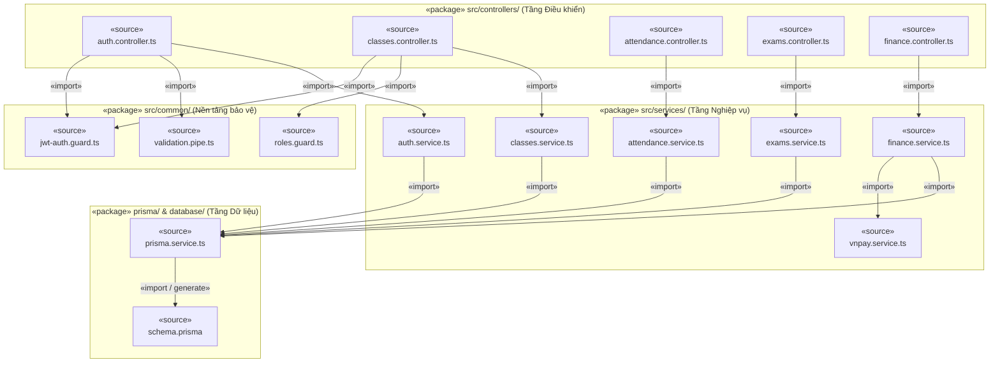
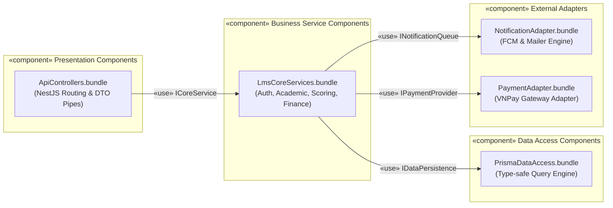
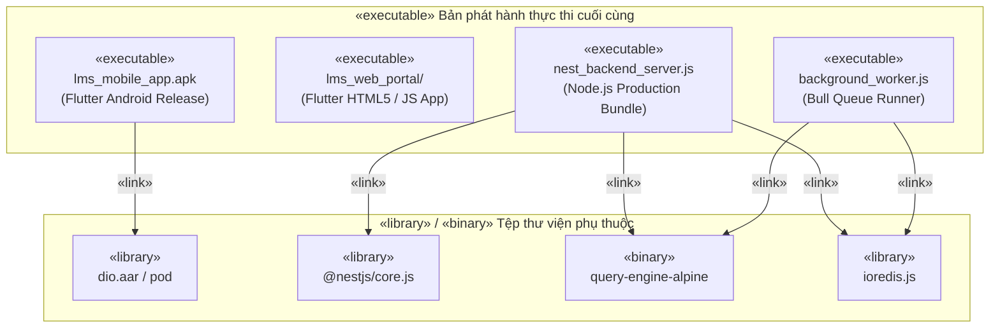
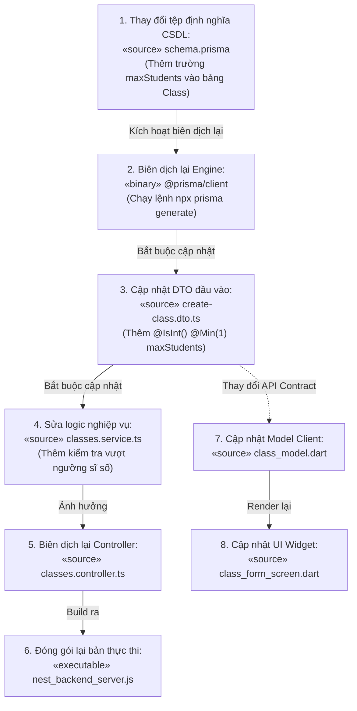

# 🏛️ BÀI TẬP TRÊN LỚP SỐ 3: THIẾT KẾ CÁC KHUNG NHÌN KIẾN TRÚC
## TASK #3: THIẾT KẾ VIEW KIẾN TRÚC CÀI ĐẶT (IMPLEMENTATION VIEWS)

> **Tên đề tài:** Hệ thống Quản lý Học tập (LMS) Trung tâm Ngoại ngữ  
> **Môn học:** Kiến trúc Phần mềm / Phân tích Thiết kế Hệ thống  
> **Thời gian nộp:** 23h59 ngày 23/10/2026  
> **Chuẩn thiết kế:** Unified Modeling Language (UML 2.5)  
> **Tài liệu tham khảo chính:** Slide bài giảng "Các góc nhìn Kiến trúc (Architectural Views) - Phần 04 & Slide 41, 42, 43"  

---

## 1. TỔNG QUAN VỀ IMPLEMENTATION VIEW TRONG HỆ THỐNG LMS

### 1.1. Mục đích và phạm vi của Implementation View
Theo nội dung bài giảng (Slide 23-30, Slide 41-43):
- **Implementation View (Khung nhìn Cài đặt / Phát triển)** tập trung trả lời câu hỏi cốt lõi: *"Mã nguồn, thư viện, gói phần mềm và các tệp thực thi được tổ chức như thế nào trong quá trình phát triển dự án?"*.
- Khung nhìn này ánh xạ các khái niệm trừu tượng trong **Logical View** (các Class, Interface) thành các thực thể vật lý cụ thể trong hệ thống tệp tin (Source code files, packages, binaries, DLLs, libraries, executables).
- Đối tượng thụ hưởng chính: Các lập trình viên (Developers), kỹ sư kiểm thử (QA/QC), chuyên viên cấu hình phần mềm (Configuration Managers) và kỹ sư DevOps/CI-CD.

### 1.2. Ba loại Component chuẩn theo UML (Slide 25)
Trong hệ thống LMS Trung tâm Ngoại ngữ, toàn bộ các thành phần phần mềm được phân loại chặt chẽ thành 3 nhóm:
1. **Work product components (Thành phần sản phẩm phát triển):**
   - Là các tệp mã nguồn nguyên bản do lập trình viên viết ra, các tệp schema, tệp cấu hình:
     - Phía Frontend: Tệp `.dart` (Screens, BLoC, Entities, DataSources).
     - Phía Backend: Tệp `.ts` (Controllers, Services, Guards, DTOs).
     - Phía Dữ liệu: Tệp `schema.prisma` định nghĩa lược đồ quan hệ CSDL.
2. **Deployment components (Thành phần bản phát hành / Triển khai):**
   - Là các tệp đóng gói hoặc tệp nhị phân hoàn chỉnh đủ để hệ thống có thể nạp và thực thi trên môi trường máy khách hoặc máy chủ:
     - Gói ứng dụng di động Android: `app-release.apk` (hoặc `.aab`).
     - Gói ứng dụng web: Thư mục `web_dist/` chứa `index.html`, `main.dart.js`, tài nguyên tĩnh.
     - Gói Backend biên dịch: Thư mục `dist/` chứa `main.js`, `app.module.js` đã transpile sang JavaScript.
     - Các thư viện phụ thuộc: Thư mục `node_modules/` và bộ image container Docker.
3. **Execution components (Thành phần hình thành lúc chạy):**
   - Là các đối tượng hoặc instance thực thể chỉ tồn tại trong bộ nhớ RAM lúc tiến trình đang chạy (Runtime instances):
     - Đối tượng `PrismaClient Connection Pool` (quản lý 10-20 kết nối SQL active).
     - Đối tượng `RedisClient Connection` kết nối socket đến cổng 6379.
     - Đối tượng `NestApplication Instance` lắng nghe trên cổng 3000.

---

## 2. CÁCH TỔ CHỨC MÃ NGUỒN VÀ QUAN HỆ GIỮA CÁC ĐỐI TƯỢNG PHỤC VỤ CÀI ĐẶT

Hệ thống LMS được tổ chức thành cấu trúc kho mã nguồn đồng nhất theo mô hình đa tầng chuẩn quốc tế:
- **Client (Flutter):** Áp dụng **Feature-First Clean Architecture** kết hợp BLoC Pattern.
- **Server (NestJS):** Áp dụng **Module-Based Layered Architecture** chuẩn Enterprise.

### 2.1. Cấu trúc tổ chức thư mục mã nguồn phía Client (Flutter)
Mã nguồn được phân tách theo từng tính năng nghiệp vụ (`features/`), cô lập sự phụ thuộc:

```
lib/
├── core/                               # Tầng dùng chung toàn hệ thống
│   ├── network/                        # Cấu hình Dio HTTP Client & Interceptors (gắn JWT)
│   ├── theme/                          # Màu sắc, Typography, AppTheme
│   ├── utils/                          # Bộ định dạng tiền tệ VND, ngày giờ
│   └── constants/                      # API Endpoints, Storage Keys
├── features/                           # Các module nghiệp vụ độc lập
│   ├── auth/                           # Module Xác thực & Đổi mật khẩu lần đầu
│   ├── classes/                        # Module Lớp học & Thời khóa biểu
│   ├── attendance/                     # Module Điểm danh (dành cho Giáo viên)
│   ├── assignments/                    # Module Bài tập & Ghi âm phát âm
│   ├── exams/                          # Module Thi trực tuyến & Đồng hồ đếm ngược
│   │   ├── data/                       # Tầng Dữ liệu: ExamModel, ExamRemoteDataSource, ExamRepositoryImpl
│   │   ├── domain/                     # Tầng Nghiệp vụ thuần Dart: ExamEntity, SubmitExamUseCase, IExamRepository
│   │   └── presentation/               # Tầng Giao diện: ExamBloc, ExamScreen, CountdownTimerWidget
│   └── finance/                        # Module Học phí & Cổng thanh toán VNPay
└── shared/                             # Reusable Widgets (AppButton, AudioPlayerBar, CustomDialog)
```

### 2.2. Cấu trúc tổ chức thư mục mã nguồn phía Backend (NestJS)
Toàn bộ mã nguồn backend được module hóa, mỗi module khép kín gồm Controller, Service, DTO và Entity:

```
backend/
├── prisma/
│   ├── schema.prisma                   # Single Source of Truth cho 25+ bảng CSDL
│   └── migrations/                     # Lịch sử thay đổi cấu trúc bảng CSDL
├── src/
│   ├── common/                         # Các bộ lọc và chốt chặn bảo mật hệ thống
│   │   ├── guards/                     # JwtAuthGuard, RolesGuard (RBAC)
│   │   ├── filters/                    # HttpExceptionFilter (Chuẩn hóa mã lỗi JSON)
│   │   ├── interceptors/               # LoggingInterceptor, TransformInterceptor
│   │   └── pipes/                      # ValidationPipe (Xác thực DTO tự động)
│   ├── config/                         # Nạp biến môi trường (.env: Database, Redis, JWT Secret)
│   ├── database/                       # PrismaService kết nối PostgreSQL
│   └── modules/                        # Các module tính năng hệ thống
│       ├── auth/                       # auth.controller.ts, auth.service.ts, jwt.strategy.ts
│       ├── classes/                    # classes.controller.ts, classes.service.ts, dto/
│       ├── attendance/                 # attendance.controller.ts, attendance.service.ts
│       ├── exams/                      # exams.controller.ts, exams.service.ts, scoring.service.ts
│       ├── finance/                    # finance.controller.ts, finance.service.ts, vnpay.service.ts
│       └── notifications/              # notifications.consumer.ts, fcm.service.ts, mail.service.ts
└── dist/                               # Thư mục mã nhị phân JavaScript biên dịch (Deployment)
```

### 2.3. Quy tắc phụ thuộc mã nguồn (Dependency Rule)
1. **Nguyên tắc đảo ngược phụ thuộc (Dependency Inversion Principle - DIP):** Tầng giao diện hoặc tầng dịch vụ cấp cao không bao giờ phụ thuộc trực tiếp vào triển khai chi tiết của cơ sở dữ liệu. Mọi tương tác đều thông qua các bản giao ước trừu tượng (**Interfaces**).
2. **Quy tắc luồng gọi một chiều:**
   $$Controller \xrightarrow{«use»} Service Interface \xrightarrow{«realize»} Service Implementation \xrightarrow{«use»} Repository Interface \xrightarrow{«realize»} PrismaService$$
3. Nhờ quy tắc này, khi thay thế cơ sở dữ liệu từ PostgreSQL sang MySQL hoặc thay thế thư viện HTTP từ Dio sang Http thông thường, toàn bộ logic nghiệp vụ (Use Cases/Services) được giữ nguyên vẹn 100%.

---

## 3. BẢNG ÁNH XẠ LOGICAL CLASSES SANG SOURCE COMPONENTS (Theo Slide 41)

Bảng dưới đây ánh xạ trực tiếp các lớp trong **Logical View (Task #1)** thành các tệp mã nguồn cụ thể (`«source» components`) phục vụ cho kỹ sư lập trình cài đặt hệ thống:

| Nhóm chức năng | Tên Lớp trong Logical View | Tệp mã nguồn vật lý (Source Component) | Vai trò cài đặt cụ thể |
|:---|:---|:---|:---|
| **Xác thực & Bảo mật** | `User`, `StudentProfile`, `TeacherProfile` | `src/modules/auth/entities/user.entity.ts`<br>`prisma/schema.prisma` | Định nghĩa thuộc tính thực thể người dùng và lược đồ bảng dữ liệu người dùng. |
| | `AuthService`, `JwtAuthGuard` | `src/modules/auth/auth.service.ts`<br>`src/common/guards/jwt-auth.guard.ts` | Cài đặt logic băm bcrypt, phát hành token JWT và chốt chặn xác thực. |
| | `AuthController` | `src/modules/auth/auth.controller.ts` | Định nghĩa các endpoint REST: `/auth/login`, `/auth/first-login`. |
| **Quản lý Lớp & Lịch học** | `Class`, `Session`, `Course`, `Room` | `src/modules/classes/dto/create-class.dto.ts`<br>`prisma/schema.prisma` | Định nghĩa DTO xác thực đầu vào và bảng quan hệ lớp học, phòng học. |
| | `ClassService` | `src/modules/classes/classes.service.ts` | Cài đặt thuật toán tự sinh các buổi học (`sessions`) và kiểm tra trùng lịch. |
| | `ClassController` | `src/modules/classes/classes.controller.ts` | Định nghĩa các endpoint quản lý lớp học và xuất thời khóa biểu. |
| **Điểm danh & Chuyên cần** | `AttendanceRecord` | `src/modules/attendance/dto/mark-attendance.dto.ts` | Cấu trúc dữ liệu ghi nhận điểm danh (status, note). |
| | `AttendanceService` | `src/modules/attendance/attendance.service.ts` | Ghi nhận điểm danh vào CSDL và phát sinh sự kiện thông báo cho phụ huynh. |
| | `AttendanceController` | `src/modules/attendance/attendance.controller.ts` | Tiếp nhận yêu cầu điểm danh từ ứng dụng di động giáo viên. |
| **Bài tập & Luyện phát âm** | `Assignment`, `AssignmentSubmission` | `src/modules/assignments/assignments.service.ts` | Quản lý giao bài tập và xử lý liên kết file âm thanh ghi âm nộp bài. |
| | `UploadService` | `src/modules/upload/upload.service.ts` | Cung cấp interface tải file ghi âm lên Google Firebase Cloud Storage. |
| **Thi trực tuyến & Chấm điểm** | `Exam`, `ExamQuestion`, `ExamAttempt` | `src/modules/exams/exams.service.ts`<br>`src/modules/exams/scoring.service.ts` | Cài đặt bộ đếm giờ server, thuật toán tự động so khớp đáp án trắc nghiệm. |
| | `ExamController` | `src/modules/exams/exams.controller.ts` | Định nghĩa endpoint nộp bài thi `/exams/:id/submit`. |
| **Học phí & Thanh toán** | `Invoice`, `PaymentReceipt` | `src/modules/finance/finance.service.ts` | Quản lý công nợ học phí, tự động tính tổng tiền khi xếp lớp. |
| | `VNPayService` | `src/modules/finance/vnpay.service.ts` | Khởi tạo URL thanh toán VNPay và kiểm tra chữ ký mã hóa bảo mật SHA-512. |
| | `FinanceController` | `src/modules/finance/finance.controller.ts` | Endpoint tiếp nhận Webhook đối soát IPN từ cổng thanh toán. |
| **Thông báo & Tác vụ nền** | `NotificationService`, `QueueEngine` | `src/modules/notifications/notifications.consumer.ts`<br>`src/modules/notifications/fcm.service.ts` | Tiến trình công nhân lắng nghe Bull Queue và gọi FCM API bắn thông báo. |
| **Giao diện Client Mobile** | `LoginScreen`, `ExamScreen`, `ExamBloc` | `lib/features/exams/presentation/exam_screen.dart`<br>`lib/features/exams/presentation/exam_bloc.dart` | Giao diện làm bài thi trực tuyến và khối quản lý trạng thái Reactive BLoC. |

---

## 4. CÁC BIỂU ĐỒ UML COMPONENT VIEW

### 4.1. Biểu đồ phụ thuộc mã nguồn giữa các tệp (Source Code Dependency Diagram - Slide 42)
Biểu diễn các tệp mã nguồn nguyên bản (`«source» components`) và quan hệ phụ thuộc `«import»` theo đúng ví dụ ATM của bài giảng (Slide 42):



---

### 4.2. Biểu đồ Component phân tầng với Interfaces (Lollipop / Socket Notation - Slide 28)
Thể hiện vai trò của các **Interface** như chất keo liên kết giữa các thành phần phần mềm độc lập:
- Ký hiệu hình tròn có cuống `O-` (Provided Interface): Component cung cấp tập hợp dịch vụ.
- Ký hiệu hình bán nguyệt `-(` (Required Interface): Component phụ thuộc hoặc tiêu thụ dịch vụ.



#### Định nghĩa đặc tả các Giao diện cốt lõi (Interface Definitions):
1. **`ICoreService`:** Định nghĩa các hợp đồng gọi nghiệp vụ giữa Controller và Service:
   - `enrollStudent(classId, studentId): Promise<EnrollmentResult>`
   - `submitExamAttempt(attemptId, answers): Promise<GradingResult>`
2. **`IDataPersistence`:** Giao diện trừu tượng hóa việc truy vấn cơ sở dữ liệu:
   - `findClassWithCapacityLock(classId): Promise<Class>`
   - `saveAttendanceRecords(records: AttendanceRecord[]): Promise<void>`
3. **`INotificationQueue`:** Giao diện trung gian đẩy công việc vào hàng đợi:
   - `enqueuePushNotification(targetToken: string, payload: object): Promise<void>`
4. **`IPaymentProvider`:** Giao diện tích hợp cổng tài chính:
   - `generatePaymentUrl(invoice: Invoice): string`
   - `verifyWebhookSignature(params: object, signature: string): boolean`

---

### 4.3. Biểu đồ Bản phát hành thực thi (Executable Release Diagram - Slide 43)
Biểu diễn cách các tệp mã nguồn sau khi build được đóng gói và liên kết (`«link»`, `«deploy»`) thành các tệp thực thi cuối cùng (`«executable»`, `«binary»`, `«library»`):



---

## 5. PHÂN TÍCH TÁC ĐỘNG CỦA THAY ĐỔI MÃ NGUỒN (CHANGE IMPACT ANALYSIS - Theo Slide 30)

Trong slide bài giảng (Slide 30), tác giả nhấn mạnh tầm quan trọng của sơ đồ mã nguồn trong việc lần vết và kiểm soát ảnh hưởng lan truyền khi sửa đổi một tệp gốc (`signal.h` thay đổi dẫn đến biên dịch lại `signal.cpp`, `interp.cpp`, `device.cpp`).

Trong hệ thống LMS Trung tâm Ngoại ngữ, mô hình phân tích tác động được mô tả như sau:



### Đánh giá mức độ lan truyền ảnh hưởng:
1. **Nếu sửa đổi logic nội bộ trong `classes.service.ts` (ví dụ: đổi thuật toán xếp lịch):**
   - Chỉ duy nhất tệp `classes.service.ts` phải biên dịch lại; các tệp `schema.prisma`, `class_model.dart` trên Flutter hoàn toàn không bị ảnh hưởng.
2. **Nếu thay đổi cấu trúc bảng trong `schema.prisma`:**
   - Đây là thay đổi cấp cơ sở: Bắt buộc chạy migration -> sinh lại `@prisma/client` -> cập nhật DTO -> cập nhật Service -> cập nhật phía Client. Điều này chứng minh kiến trúc đã kiểm soát chặt chẽ tính toàn vẹn thông qua hệ thống Type-safe từ đầu đến cuối.

---

## 6. KẾT LUẬN TASK #3
Khung nhìn kiến trúc Cài đặt (Implementation View) đã thiết lập cẩm nang kỹ thuật toàn diện cho đội ngũ phát triển:
1. **Quy chuẩn cấu trúc tệp tin:** Phân tầng rõ ràng theo chuẩn Feature-First Clean Architecture trên Flutter và Module Layered trên NestJS.
2. **Bảng ánh xạ chuẩn xác:** Chuyển đổi 100% các lớp logic trong Logical View thành các tệp mã nguồn vật lý cụ thể trong dự án.
3. **Bộ 3 sơ đồ Component chuẩn UML:**
   - Sơ đồ phụ thuộc mã nguồn với liên kết `«import»`.
   - Sơ đồ Component liên kết qua Interface theo chuẩn hình que kẹo (Lollipop).
   - Sơ đồ phát hành thực thi với các tệp `.apk`, `dist/main.js` và thư viện liên kết `«link»`.
4. **Phân tích tác động thay đổi:** Giúp lập trình viên lường trước phạm vi ảnh hưởng khi cập nhật mã nguồn, đảm bảo tính bền vững của dự án.
5. Khung nhìn này tạo tiền đề để ánh xạ các thành phần thực thi lên các máy chủ phần cứng trong **Deployment View (Task #4)**.
