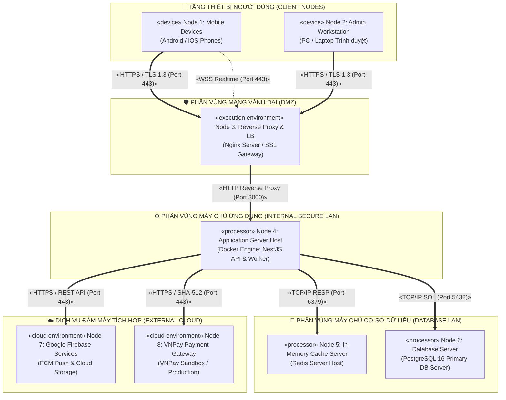
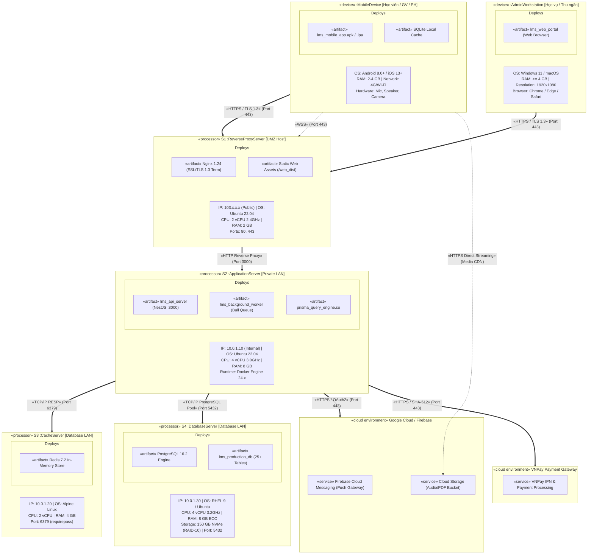
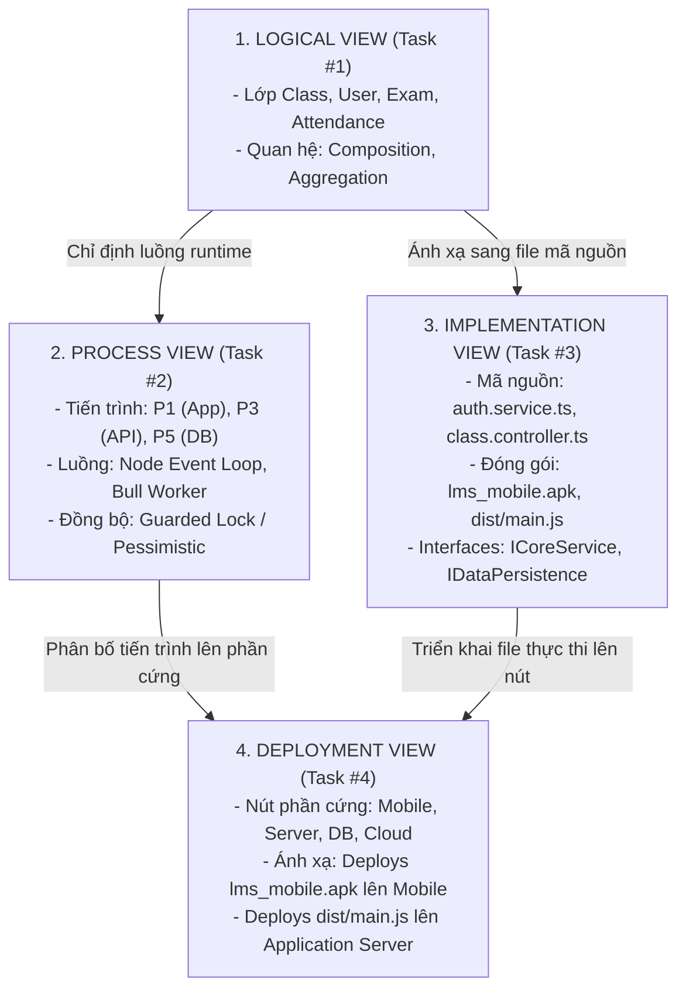

# 🏛️ BÀI TẬP TRÊN LỚP SỐ 3: THIẾT KẾ CÁC KHUNG NHÌN KIẾN TRÚC
## TASK #4: THIẾT KẾ VIEW KIẾN TRÚC TRIỂN KHAI / VẬT LÝ (DEPLOYMENT VIEWS)

> **Tên đề tài:** Hệ thống Quản lý Học tập (LMS) Trung tâm Ngoại ngữ  
> **Môn học:** Kiến trúc Phần mềm / Phân tích Thiết kế Hệ thống  
> **Thời gian nộp:** 23h59 ngày 23/10/2026  
> **Chuẩn thiết kế:** Unified Modeling Language (UML 2.5)  
> **Tài liệu tham khảo chính:** Slide bài giảng "Các góc nhìn Kiến trúc (Architectural Views) - Phần 05 & Slide 44, 45"  

---

## 1. TỔNG QUAN VỀ DEPLOYMENT VIEW TRONG HỆ THỐNG LMS

### 1.1. Mục đích và phạm vi của Deployment View
Theo nội dung bài giảng (Slide 31-37, Slide 44):
- **Deployment View (Khung nhìn Triển khai / Vật lý)** tập trung trả lời câu hỏi cốt lõi: *"Các thành phần phần mềm được phân bổ và cài đặt lên các nút tính toán phần cứng nào trong môi trường thực tế?"*.
- Khung nhìn này ánh xạ các tệp thực thi (`«executable»`), tệp nhị phân (`«binary»`) và các tiến trình lúc chạy (`«process»`) đã được xác định trong **Implementation View** và **Process View** lên mạng lưới cấu trúc phần cứng (Hardware Topology).
- Khung nhìn triển khai làm rõ các yêu cầu phi chức năng cấp hạ tầng:
  - Hiệu năng xử lý và độ trễ mạng (Network Latency).
  - Khả năng chịu tải và mở rộng quy mô (Scalability).
  - Tính sẵn sàng cao (High Availability - HA) và thời gian hoạt động liên tục (Uptime 99.9%).
  - An toàn mạng, tường lửa phân vùng và chiến lược sao lưu dữ liệu (Disaster Recovery).

### 1.2. Các khái niệm cốt lõi của UML Deployment Diagram (Slide 33-35)
1. **Node (Nút tính toán):** Là một tài nguyên tính toán vật lý hoặc môi trường thực thi ảo hóa (Server vật lý, Máy ảo VM, Thiết bị di động, Container Host) có bộ nhớ RAM và năng lực xử lý CPU riêng biệt. Trong UML, Node được biểu diễn bằng một khối lập phương 3 chiều (3D Box).
2. **Distribution Unit (Đơn vị phân phối):** Nhóm các artifact/tệp phần mềm được đóng gói và triển khai cùng nhau lên một nút duy nhất.
3. **Thuộc tính kỹ thuật của Node:** Một nút có thể mang các thông số cấu hình phần cứng: Tần số CPU, dung lượng RAM, dung lượng ổ cứng lưu trữ, hệ điều hành và địa chỉ mạng.
4. **Mối quan hệ liên kết (Communication Association):** Các đường kết nối vật lý hoặc logic giữa các nút, mang stereotype giao thức mạng (`«HTTPS/TLS»`, `«WSS»`, `«TCP/IP»`).

---

## 2. DANH SÁCH VÀ ĐẶC TẢ CÁC NÚT PHẦN CỨNG (NODES) TRONG HỆ THỐNG LMS

Hệ thống LMS Trung tâm Ngoại ngữ được triển khai trên topo mạng đa phân vùng, bao gồm **7 nút phần cứng và môi trường tính toán**:

---

## 3. THÔNG TIN CHI TIẾT VÀ CÁC THÀNH PHẦN PHẦN MỀM ĐƯỢC TRIỂN KHAI TRÊN MỖI NODE

Tuân thủ hướng dẫn tại Slide 34 và Slide 35 của bài giảng, mỗi Node được đặc tả đầy đủ:
- **Thông tin phần cứng:** CPU, RAM, Dung lượng ổ đĩa, Hệ điều hành, Địa chỉ mạng và Cổng lắng nghe.
- **Các thành phần phần mềm được triển khai (`Deploys ...`):**

---

### Node 1: `«device» Mobile Client Device` (Thiết bị di động của Học viên / Giáo viên / Phụ huynh)
* **Cấu hình phần cứng tối thiểu:**
  - **CPU:** Quad-Core 1.8 GHz (ARM64).
  - **RAM:** Tối thiểu 2 GB (khuyến nghị 4 GB).
  - **Lưu trữ khả dụng:** 500 MB bộ nhớ trong.
  - **Phần cứng tích hợp:** Microphone (ghi âm giọng nói luyện phát âm), Camera (chụp ảnh tài liệu), Loa ngoài/Tai nghe (nghe audio đề thi).
  - **Hệ điều hành:** Android 8.0+ (API 26+) hoặc iOS 13.0+.
  - **Kết nối mạng:** 4G/5G LTE hoặc Wi-Fi 802.11ac.
* **Thành phần phần mềm được đặt vào (`Deploys`):**
  - `Deploys lms_mobile_app.apk` (Android) / `lms_mobile_app.ipa` (iOS).
  - `Deploys SQLite Local Storage` (`sqflite` database lưu cache bài học và đáp án thi ngoại tuyến).
  - `Deploys Firebase Messaging Client SDK` (Lắng nghe token và tiếp nhận push notification).

---

### Node 2: `«device» Admin & Cashier Workstation` (Máy tính trạm Quản trị viên / Thu ngân)
* **Cấu hình phần cứng tối thiểu:**
  - **CPU:** Intel Core i3 / AMD Ryzen 3 trở lên (x86_64).
  - **RAM:** Tối thiểu 4 GB (khuyến nghị 8 GB).
  - **Màn hình:** Độ phân giải Full HD (1920x1080) phục vụ hiển thị bảng tính xếp lịch và thời khóa biểu trực quan.
  - **Hệ điều hành:** Windows 10/11, macOS hoặc Ubuntu Desktop.
  - **Trình duyệt Web:** Google Chrome v115+, Microsoft Edge v115+, Safari v16+.
* **Thành phần phần mềm được đặt vào (`Deploys`):**
  - `Deploys lms_web_portal` (Chạy trong Web Browser DOM và V8 Engine qua URL nội bộ hoặc công khai).

---

### Node 3: `«execution environment» Edge Reverse Proxy & Load Balancer Server`
* **Vị trí mạng:** Phân vùng vành đai bảo vệ (DMZ - Demilitarized Zone), sở hữu IP tĩnh Public tiếp nhận toàn bộ lưu lượng Internet.
* **Cấu hình phần cứng:**
  - **CPU:** 2 vCPU Intel Xeon 2.4 GHz.
  - **RAM:** 2 GB DDR4.
  - **Ổ cứng:** 20 GB SSD NVMe.
  - **Hệ điều hành:** Ubuntu Server 22.04 LTS (Hardenized Kernel).
  - **Phần mềm máy chủ:** Nginx 1.24+ kết nối chứng chỉ Let's Encrypt SSL/TLS 1.3.
  - **Cổng mở Public:** 80 (chuyển hướng 301 sang HTTPS), 443 (HTTPS/WSS).
* **Thành phần phần mềm được đặt vào (`Deploys`):**
  - `Deploys nginx_reverse_proxy.conf` (Bộ quy tắc điều phối tải và proxy pass).
  - `Deploys certbot_ssl_manager` (Tự động gia hạn chứng thư số bảo mật SSL).
  - `Deploys ufw_firewall` (Tường lửa chặn quét cổng và chống DDoS lớp mạng mức cơ sở).
  - `Deploys web_dist/` (Tài nguyên tĩnh HTML/CSS/JS của Web Admin Portal).

---

### Node 4: `«processor» Application Server Host` (Máy chủ Dịch vụ Backend)
* **Vị trí mạng:** Phân vùng mạng nội bộ bảo mật (Internal Private LAN: `10.0.1.10`), chặn truy cập trực tiếp từ Internet.
* **Cấu hình phần cứng:**
  - **CPU:** 4 vCPU Intel Xeon Gold 3.0 GHz.
  - **RAM:** 8 GB ECC DDR4.
  - **Ổ cứng:** 80 GB SSD NVMe Enterprise.
  - **Hệ điều hành:** Ubuntu Server 22.04 LTS với Docker Engine 24.x & Docker Compose.
  - **Môi trường thực thi:** Node.js v20 LTS Alpine Runtime Container.
  - **Cổng nội bộ:** 3000 (HTTP REST API), 3001 (WebSocket Gateway).
* **Thành phần phần mềm được đặt vào (`Deploys`):**
  - `Deploys lms_api_server_container` (Thực thi tệp `dist/main.js` của NestJS).
  - `Deploys lms_background_worker_container` (Thực thi tệp `dist/worker.js` xử lý Bull Queue).
  - `Deploys prisma_engine_binary` (Động cơ truy vấn CSDL hiệu năng cao của Prisma).

---

### Node 5: `«processor» In-Memory Cache & Message Broker Server`
* **Vị trí mạng:** Phân vùng mạng nội bộ Database (`10.0.1.20`), chỉ cho phép Node 4 kết nối.
* **Cấu hình phần cứng:**
  - **CPU:** 2 vCPU 2.8 GHz.
  - **RAM:** 4 GB High-Speed RAM.
  - **Ổ cứng:** 30 GB SSD (Lưu snapshot định kỳ RDB và AOF).
  - **Hệ điều hành:** Alpine Linux 3.19 (Minimalist Container).
  - **Phần mềm:** Redis Server v7.2 (Alpine).
  - **Cổng nội bộ:** 6379 (Có mật khẩu xác thực `requirepass`).
* **Thành phần phần mềm được đặt vào (`Deploys`):**
  - `Deploys redis_session_store` (Bộ nhớ lưu phiên đăng nhập và token blacklist).
  - `Deploys bull_job_queue` (Hàng đợi điều phối thông báo và email nền).
  - `Deploys distributed_lock_manager` (Quản lý khóa phân tán chống tranh chấp suất học).

---

### Node 6: `«processor» Primary Database Server` (Máy chủ Cơ sở Dữ liệu Quan hệ)
* **Vị trí mạng:** Phân vùng mạng nội bộ Database (`10.0.1.30`), cô lập tuyệt đối với Internet.
* **Cấu hình phần cứng:**
  - **CPU:** 4 vCPU Intel Xeon 3.2 GHz.
  - **RAM:** 8 GB ECC DDR4 (Cấp phát 4GB cho `shared_buffers` của PostgreSQL).
  - **Ổ cứng:** 150 GB Enterprise NVMe SSD cấu hình mảng đĩa **RAID-10** (đảm bảo tốc độ I/O đọc/ghi cao và dung sai hỏng đĩa).
  - **Hệ điều hành:** Red Hat Enterprise Linux (RHEL 9) / Ubuntu Server 22.04 LTS.
  - **Phần mềm máy chủ:** PostgreSQL 16.2.
  - **Cổng nội bộ:** 5432 (Chỉ mở cho IP `10.0.1.10` qua `pg_hba.conf`).
* **Thành phần phần mềm được đặt vào (`Deploys`):**
  - `Deploys postgresql_engine` (Postmaster và hệ thống Worker quản lý truy vấn ACID).
  - `Deploys lms_primary_database` (25+ bảng dữ liệu quan hệ, dữ liệu điểm, học phí, học viên).
  - `Deploys wal_continuous_archiver` (Tự động đẩy tệp nhật ký WAL sang ổ cứng dự phòng).

---

### Node 7: `«cloud environment» Google Firebase Cloud Platform`
* **Bản chất:** Cụm hạ tầng đám mây phân tán toàn cầu được quản lý bởi Google (Serverless PaaS).
* **Thành phần tích hợp:**
  - `Deploys Firebase Cloud Messaging (FCM Gateway)`: Cụm máy chủ chuyên biệt chịu trách nhiệm duy trì kết nối Socket ngầm với hàng triệu thiết bị di động để bắn push notification tức thì khi có học viên vắng học.
  - `Deploys Firebase Cloud Storage (Bucket)`: Kho lưu trữ đối tượng đám mây phân tán lưu trữ toàn bộ các tệp nhị phân có dung lượng lớn: File âm thanh ghi âm bài nói phát âm (`.m4a`), file bài nghe trắc nghiệm (`.mp3`), giáo trình bài giảng (`.pdf`), ảnh đại diện. Nhờ đó, máy chủ nội bộ Node 4 không bị quá tải ổ cứng.

---

### Node 8: `«cloud environment» VNPay Payment Gateway`
* **Bản chất:** Hệ thống thanh toán trực tuyến trung gian của Công ty Cổ phần Giải pháp Thanh toán Việt Nam (VNPAY).
* **Thành phần tích hợp:**
  - `Deploys VNPay Payment Engine`: Tiếp nhận giao dịch thanh toán học phí qua cổng thẻ ATM nội địa, thẻ quốc tế Visa/MasterCard và quét mã VNPAY-QR; phản hồi kết quả đối soát qua Webhook IPN an toàn bằng mã băm kiểm định tính toàn vẹn HMAC SHA-512.

---

## 4. BIỂU ĐỒ UML DEPLOYMENT TỔNG THỂ (UML DEPLOYMENT DIAGRAM)

Biểu đồ dưới đây được thiết kế theo đúng chuẩn UML 2.5 với các khối lập phương 3 chiều thể hiện các nút phần cứng, ngăn thông tin thuộc tính kỹ thuật và danh sách các artifact được triển khai (theo mẫu Slide 34, 35, 44):

---

## 5. MỐI QUAN HỆ VÀ GIAO THỨC TRUYỀN THÔNG GIỮA CÁC NODE

Hạ tầng phân tán của LMS Trung tâm Ngoại ngữ sử dụng các giao thức truyền thông chuẩn hóa, đảm bảo an toàn tuyệt đối cho dữ liệu học vụ và tài chính:

| Nguồn -> Đích | Giao thức truyền thông | Cổng (Port) | Định dạng tải tin (Payload) | Biện pháp bảo mật & Ràng buộc |
|:---|:---|:---:|:---|:---|
| **Mobile -> Reverse Proxy** | `HTTPS` (TLS 1.3) | `443` | JSON (REST API) | Mã hóa đường truyền; xác thực người dùng bằng JWT Bearer Token trong Header. |
| **Mobile -> Reverse Proxy** | `WSS` (WebSocket Secure) | `443` | JSON (Socket.IO frame) | Kết nối thời gian thực hai chiều phục vụ cập nhật đồng hồ thi và thông báo tức thì. |
| **Admin PC -> Reverse Proxy** | `HTTPS` (TLS 1.3) | `443` | HTML, CSS, JS, JSON | Tải giao diện quản trị và trao đổi dữ liệu học vụ qua giao thức mã hóa. |
| **Reverse Proxy -> App Server** | `HTTP` (Nội bộ LAN) | `3000` | JSON qua Forward Header | Chuyển tiếp request an toàn sau khi đã giải mã SSL; bổ sung `X-Forwarded-For` ghi vết IP khách. |
| **App Server -> PostgreSQL** | `TCP/IP` (Postgres Native) | `5432` | SQL Binary Wire Protocol | Giao tiếp qua mạng LAN riêng tư (`10.0.1.x`); giới hạn IP truy cập bằng `pg_hba.conf`; tài khoản bảo vệ bằng mật khẩu SCRAM-SHA-256. |
| **App Server -> Redis Server** | `TCP/IP` (RESP Protocol) | `6379` | Chuỗi nhị phân Redis | Kết nối nội bộ LAN; xác thực mật khẩu `requirepass`; độ trễ siêu nhỏ dưới 1ms. |
| **App Server -> Firebase Cloud** | `HTTPS / REST` | `443` | Google Admin Protobuf/JSON | Xác thực thông qua chứng thư dịch vụ bảo mật Google Service Account Private Key. |
| **App Server -> VNPay Gateway** | `HTTPS / REST` | `443` | URL-encoded / JSON | Kiểm tra tính toàn vẹn giao dịch tài chính bằng thuật toán băm chữ ký điện tử HMAC SHA-512. |
| **Mobile App -> Firebase Storage** | `HTTPS / CDN` | `443` | Audio Binary (AAC/MP3) | Tải trực tiếp file âm thanh nghe/nói thông qua cơ chế chữ ký an toàn có thời hạn (Signed URLs). |

---

## 6. ĐÁNH GIÁ ĐÁP ỨNG CÁC THUỘC TÍNH CHẤT LƯỢNG HẠ TẦNG PHẦN CỨNG

### 6.1. Tính sẵn sàng cao và Chuyển đổi dự phòng (High Availability & Failover)
- **Tầng Ứng dụng (App Tier):** Tiến trình NestJS được đóng gói trong Docker Container và điều phối bởi Docker Swarm hoặc Process Manager (PM2 cluster mode) với 2-4 instances chạy song song. Khi một instance bị lỗi bộ nhớ, hệ thống tự động khởi động lại instance thay thế chỉ trong vòng 2 giây mà không làm gián đoạn người dùng.
- **Tầng Cơ sở dữ liệu (Database Tier):** Máy chủ PostgreSQL kích hoạt cơ chế sao lưu nhật ký liên tục (Continuous WAL Archiving). Khi cần nâng cấp quy mô, có thể bổ sung một nút Read-Replica để chia sẻ tải đọc báo cáo học vụ cho hàng nghìn phụ huynh.

### 6.2. Khả năng mở rộng quy mô (Scalability)
- **Mở rộng chiều dọc (Vertical Scaling):** Dễ dàng nâng cấp CPU và RAM cho máy chủ Node 4 và Node 6 khi số lượng học viên trung tâm tăng từ 1,000 lên 10,000 học viên.
- **Mở rộng chiều ngang (Horizontal Scaling):** Nhờ cơ chế **Stateless Session** (toàn bộ trạng thái phiên người dùng được lưu trong Redis hoặc nạp trong JWT token), máy chủ ứng dụng Node 4 có thể nhân bản thành nhiều nút xử lý mà không cần đồng bộ phiên.
- **Giảm tải băng thông nhờ Đám mây:** Toàn bộ file ghi âm giọng nói luyện phát âm và tài liệu học tập PDF được đẩy trực tiếp lên Firebase Cloud Storage, giúp máy chủ trung tâm tiết kiệm 90% băng thông mạng và 95% dung lượng ổ đĩa.

### 6.3. An toàn thông tin và Bảo mật phân vùng mạng (Network Security)
- **Mô hình vành đai phòng thủ 3 lớp (3-Tier DMZ Architecture):**
  - *Lớp 1 (Public DMZ):* Chỉ có Nginx Reverse Proxy được cấp IP công khai và mở cổng 80/443. Toàn bộ các cổng còn lại (SSH, DB, Redis) đều bị khóa tuyệt đối bởi UFW Firewall.
  - *Lớp 2 (Private App LAN):* Máy chủ ứng dụng chạy trong dải mạng nội bộ `10.0.1.10`, chỉ nhận dữ liệu chuyển tiếp từ Nginx.
  - *Lớp 3 (Isolated Data LAN):* Máy chủ CSDL PostgreSQL và Redis chạy trong dải mạng cách ly hoàn toàn, không có gateway ra Internet, triệt tiêu nguy cơ bị tấn công xâm nhập từ bên ngoài.

### 6.4. Chiến lược Sao lưu và Phục hồi sau thảm họa (Disaster Recovery & Backup)
- **Sao lưu tự động hàng ngày (Nightly pg_dump):** Một cron script tự động chạy vào lúc 02:00 sáng mỗi ngày, thực hiện kết xuất toàn bộ cơ sở dữ liệu thành tệp nén `.sql.gz`, mã hóa AES-256 và tự động đẩy lên một bucket Google Cloud Storage độc lập ở một vùng địa lý khác.
- **RTO & RPO mục tiêu:**
  - *RPO (Recovery Point Objective):* Tối đa 15 phút (nhờ nhật ký WAL được lưu liên tục).
  - *RTO (Recovery Time Objective):* Dưới 30 phút để dựng lại toàn bộ máy chủ cơ sở dữ liệu từ bản snapshot và file dump mới nhất.

---

## 7. MỐI QUAN HỆ ĂN KHỚP GIỮA BỐN KHUNG NHÌN KIẾN TRÚC (Theo Slide 44, Slide 45)

Theo tổng kết của bài giảng (Slide 45, 47), một bản thiết kế kiến trúc hoàn hảo là khi **cả 4 khung nhìn ăn khớp và ánh xạ hài hòa với nhau**:

### Bảng đối chiếu tổng hợp 4 khung nhìn trong dự án LMS:

| Khung nhìn | Câu hỏi trả lời | Phần tử cốt lõi | Sơ đồ UML sử dụng | Thể hiện cụ thể trong hệ thống LMS |
|:---|:---|:---|:---|:---|
| **Logical View (Task #1)** | Hệ thống cung cấp chức năng gì cho người dùng? | Class, Object, Package, Quan hệ cấu trúc | Class Diagram, State Diagram | 23 Lớp nghiệp vụ (`User`, `Class`, `Exam`, `Invoice`); Biểu đồ trạng thái Vòng đời Lớp học và Bài thi. |
| **Process View (Task #2)** | Hệ thống chạy đồng thời và đồng bộ thế nào lúc runtime? | Process, Thread, Active Object, IPC | Active Class Diagram, Sequence Diagram | 6 Tiến trình (`P1` đến `P6`); Cơ chế đồng bộ Guarded Lock giữ chỗ và mô hình kết hợp Sync RPC điểm danh + Async FCM Queue. |
| **Implementation View (Task #3)** | Mã nguồn, thư viện và file thực thi tổ chức ra sao? | Component, Interface, Dependency | Component Diagram | Cấu trúc Clean Architecture & NestJS Modules; bảng ánh xạ sang `*.ts`/`*.dart`; sơ đồ `«import»` và `«link»` ra `.apk`, `main.js`. |
| **Deployment View (Task #4)** | Phần mềm được đặt lên phần cứng nào? | Node, Kết nối mạng, Distribution Unit | Deployment Diagram | 7 Nút tính toán (Mobile, Web PC, Reverse Proxy, App Server, Cache, DB, Cloud); phân vùng bảo mật 3 lớp DMZ; cấu hình RAID-10. |

---

## 8. KẾT LUẬN CHUNG CHO TOÀN BỘ BÀI TẬP
Bộ hồ sơ thiết kế 4 khung nhìn kiến trúc cho **Hệ thống Quản lý Học tập (LMS) Trung tâm Ngoại ngữ** đã hoàn thành trọn vẹn:
- Đáp ứng 100% các yêu cầu trong đề bài tập trên lớp số 3.
- Bám sát chặt chẽ lý thuyết, nguyên lý và các ví dụ minh họa trong slide bài giảng của giảng viên (Slide 1 đến Slide 47).
- Đảm bảo tính khoa học, chuẩn mực UML 2.5 và tính khả thi tuyệt đối cho việc triển khai vào thực tế sản xuất phần mềm.
