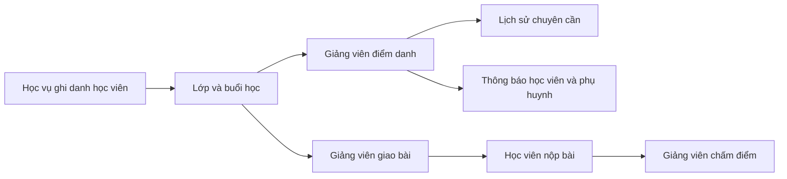

# Báo cáo tiến độ: lớp học, giảng viên, học viên, bài tập, điểm danh

Ngày kiểm tra: 26/10/2026. Phạm vi là luồng học tập có dữ liệu thật trên PostgreSQL và API NestJS, cùng các đường vào Flutter Web/Android tương ứng.

## Kịch bản trình bày

1. Đăng nhập web bằng `GV-0001`, mở **Lớp học của tôi** để xem `DEMO-IELTS-2026` và 12 học viên. Lịch dạy có các buổi thực theo ngày. Học vụ có thể ghi danh bằng mã học viên, không cần UUID.
2. Mở **Điểm danh**, chọn lớp và buổi học, đánh dấu một học viên vắng rồi lưu. Học viên và phụ huynh liên kết nhận thông báo. Phụ huynh có thể xem lịch sử chuyên cần của từng con.
3. Mở **Bài tập & Chấm bài**, tạo bài tập cho lớp. Đăng nhập Android bằng `DEMO-HV-05`, nộp bài. Quay lại giảng viên để xem bài nộp, chấm điểm và nhận xét. Học viên xem trạng thái đã chấm.
4. Đăng nhập `DEMO-PH-01` để xem một con; `DEMO-PH-05` để xem hai con. Chọn từng con ở lịch học và mục chuyên cần.
5. Đăng nhập `DEMO-GV-02` để trình bày lớp `DEMO-COMM-2026` với 8 học viên và lịch dạy khác.

Dữ liệu được tạo bằng `cd backend && npm run seed:learning-flow` sau khi đã chạy seed nền tảng (`npm run seed`). Lệnh có thể chạy lại mà không nhân đôi dữ liệu. Có 20 tài khoản `DEMO-HV-01` đến `DEMO-HV-20`, một tài khoản `DEMO-GV-02` cộng với `GV-0001`, 12 phụ huynh `DEMO-PH-01` đến `DEMO-PH-12` (4 người một con, 8 người hai con), 2 lớp, 44 buổi học, 3 bài tập, bài nộp và điểm danh mẫu. Mật khẩu tài khoản DEMO lấy từ `DEMO_PASSWORD`, mặc định cục bộ là `Password@123`; đổi mật khẩu trước khi dùng ngoài môi trường phát triển.

Để kiểm tra lại trên máy phát triển: chạy `docker compose up -d` ở thư mục gốc, chạy `npm run start:dev` trong `backend/`, rồi chạy `npm run smoke:learning-flow` ở một terminal khác. Kịch bản dùng API mặc định `http://localhost:3000/api/v1`; đặt `SMOKE_API_URL` nếu backend chạy ở cổng khác và `SMOKE_ADMIN_PASSWORD` nếu mật khẩu admin seed đã đổi. Kịch bản tự dọn bài tập, hóa đơn và ghi danh tạo tạm.

## Luồng dữ liệu đã kiểm tra

- Quyền xem lớp, buổi học, bài tập và điểm danh được giới hạn theo vai trò, chi nhánh, phân công giảng dạy, ghi danh hoặc quan hệ cha mẹ–con. Học viên và phụ huynh chỉ nhận danh sách học viên liên quan ở chi tiết lớp.
- Tạo lớp, ghi danh và xóa ghi danh của nhân viên chi nhánh bị giới hạn trong chi nhánh được gán. Ghi danh chấp nhận UUID hoặc mã học viên và kiểm tra vai trò, trạng thái tài khoản, sĩ số.
- Điểm danh chặn học viên không thuộc lớp, danh sách trùng và buổi đã hủy; trạng thái buổi chỉ hoàn tất khi mọi học viên hiện ghi danh đã được điểm danh. Vắng học mới tạo thông báo cho học viên và phụ huynh; lưu lại cùng trạng thái không gửi lặp.
- Bài nộp rỗng bị từ chối; bài đã chấm không bị ghi đè bằng lần nộp mới. Giảng viên khác lớp không thể xem/chấm bài hoặc điểm danh.
- Mục điểm danh và bài tập trên web giảng viên hiện lấy dữ liệu API và mở các màn hình thao tác thực. Mục chuyên cần trên trang phụ huynh cho phép chọn một hoặc hai con.

## Kết quả kiểm thử

| Phạm vi | Kết quả |
|---|---|
| Backend build | Thành công |
| Backend unit tests | 104/104 thành công |
| Backend E2E tests | 6/6 thành công |
| Kịch bản API thật `npm run smoke:learning-flow` | Thành công: đăng nhập, quan hệ lớp, phụ huynh 1/2 con, tạo–nộp–chấm bài, điểm danh, thông báo, lịch học và từ chối truy cập sai quyền |
| Flutter tests chức năng chính | 51/51 thành công |
| Flutter analyzer ở các tệp luồng đã sửa | Không có lỗi; toàn dự án còn nhiều lint cũ |
| Android debug build | Thành công, tạo `build/app/outputs/flutter-apk/app-debug.apk` |

`flutter test` toàn bộ hiện còn 52 ca lỗi trong các bộ `challenger_*`. Có ca do test harness không đăng ký `ClassesRepository` trong GetIt, có ca còn kiểm tra nhãn/bố cục UI cũ, và có ca phát hiện tràn ở `teacher_attendance_view.dart` mẫu hiện không còn được trang giảng viên sử dụng. Các ca còn lại cần được phân loại và sửa theo từng nguyên nhân trước khi dùng làm cổng chặn CI. Chưa xác nhận push trên thiết bị Android thật; kịch bản API đã xác nhận bản ghi thông báo của học viên và phụ huynh trong PostgreSQL.

## Hướng phát triển tiếp theo

1. Chuẩn hóa và sửa bộ `challenger_*` thành kiểm thử theo nghiệp vụ hiện hành; bổ sung kiểm thử end to end Android cho ghi âm/nộp bài và push notification trên thiết bị thật.
2. Hoàn thiện sổ đầu bài có lưu trữ riêng, thay vì các màn hình mẫu cũ; liên kết nội dung buổi học, tài liệu và nhận xét với `ClassSession`.
3. Bổ sung bảng điểm tổng hợp và quyền xem điểm từng con cho phụ huynh; hiện luồng chấm bài của giảng viên và trạng thái bài nộp của học viên đã chạy qua API.
4. Tăng độ an toàn giao dịch ở bước ghi danh và điểm danh hàng loạt, đặc biệt khi có hai nhân viên cập nhật đồng thời; kiểm tra xung đột sĩ số và mã hóa đơn trong transaction.
5. Nếu cần tích hợp với hệ thống trường học khác, lập bản đồ dữ liệu người dùng, lớp và ghi danh theo OneRoster 1.2. Ưu tiên này đến sau khi luồng nội bộ ổn định.

Tham khảo nghiệp vụ: [Moodle Assignment](https://docs.moodle.org/503/en/mod/assignment/index), [Moodle Assignment submissions](https://docs.moodle.org/405/en/Assignment_submissions), [1EdTech OneRoster 1.2](https://standards.1edtech.org/oneroster/specifications/standards/v1p2).
