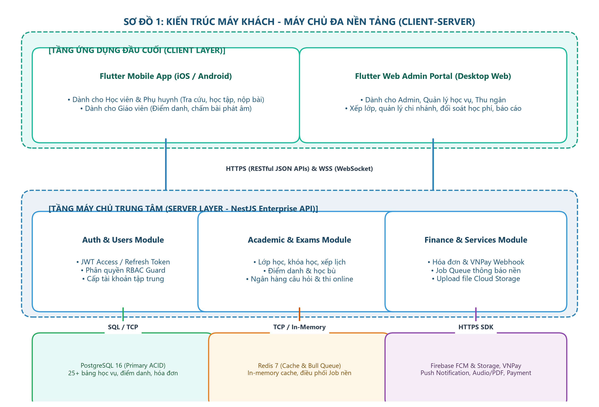
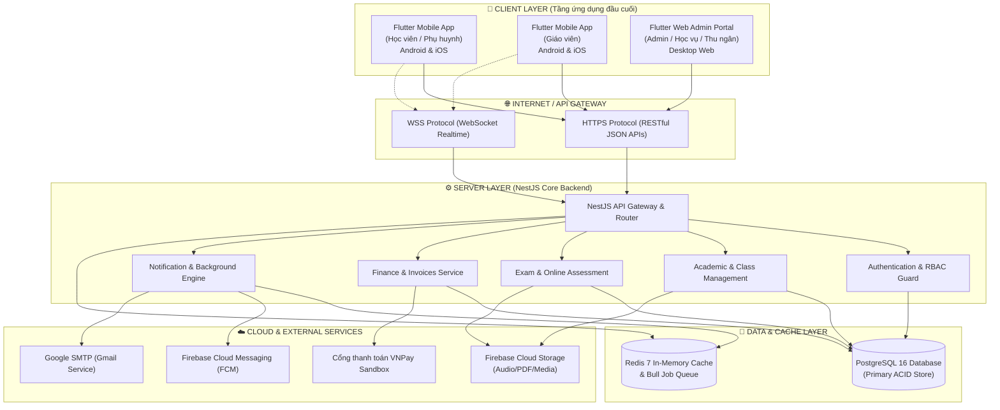
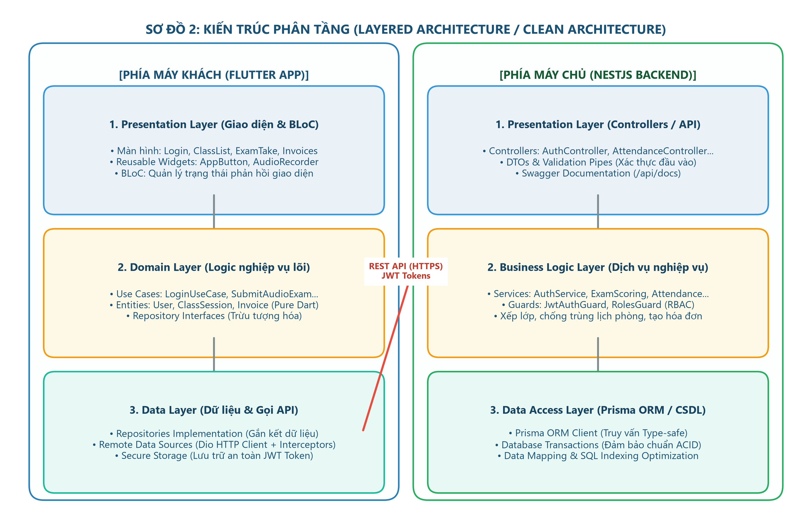
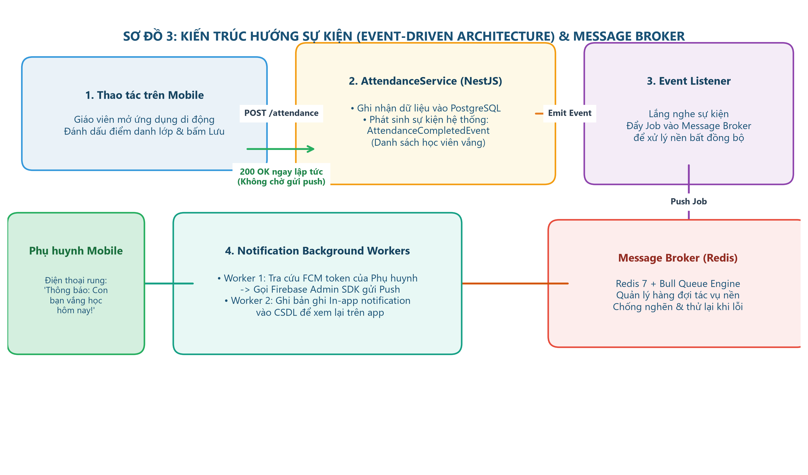
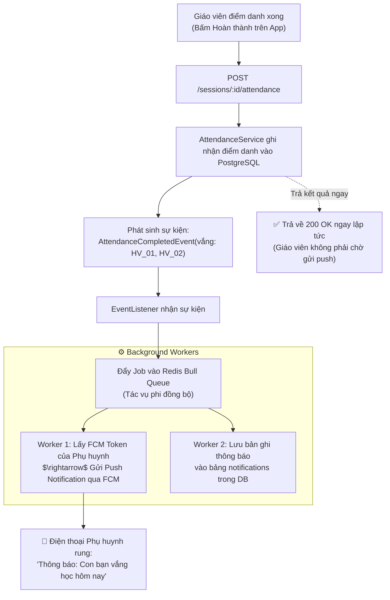
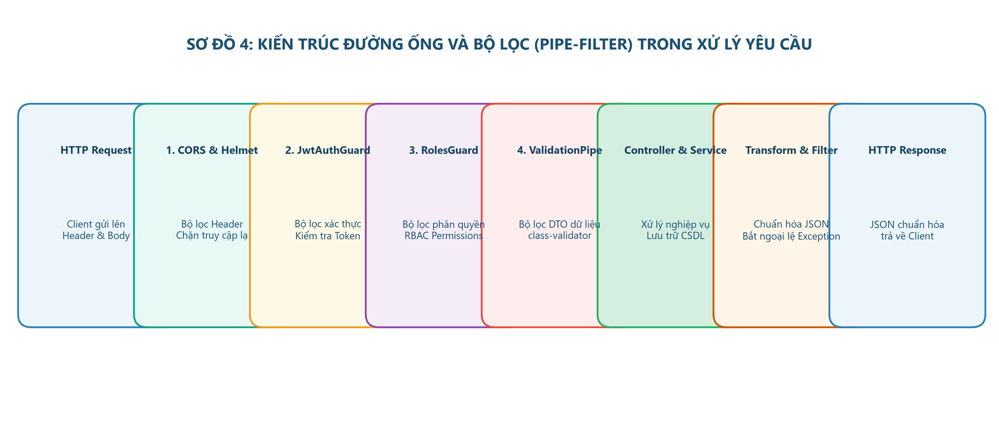

# 🏛️ BÁO CÁO THIẾT KẾ KIẾN TRÚC PHẦN MỀM (TASK #1)

## ĐỀ TÀI: XÂY DỰNG HỆ THỐNG QUẢN LÝ HỌC TẬP (LMS) TRUNG TÂM NGOẠI NGỮ

> **Môn học:** Kiến trúc Phần mềm / Phân tích Thiết kế Hệ thống  
> **Nhóm thực hiện:** Nhóm phát triển đề tài LMS  
> **Ngày thực hiện:** 09/10/2026  
> **Ngôn ngữ & Công nghệ:** Flutter (Dart) · NestJS (TypeScript) · PostgreSQL · Redis · Firebase Services  

---

## MỤC LỤC
1. [Bối cảnh nghiệp vụ & Cơ sở lựa chọn kiến trúc](#1-bối-cảnh-nghiệp-vụ--cơ-sở-lựa-chọn-kiến-trúc)
2. [Xác định các mẫu kiến trúc phần mềm](#2-xác-định-các-mẫu-kiến-trúc-phần-mềm)
   - 2.1. [Mẫu kiến trúc chính (Primary Architecture)](#21-mẫu-kiến-trúc-chính-primary-architecture)
   - 2.2. [Các mẫu kiến trúc hỗ trợ, bổ sung (Supporting Architectures)](#22-các-mẫu-kiến-trúc-hỗ-trợ-bổ-sung-supporting-architectures)
3. [Biểu đồ mô tả trực quan các kiến trúc (Block Diagrams)](#3-biểu-đồ-mô-tả-trực-quan-các-kiến-trúc-block-diagrams)
   - 3.1. [Sơ đồ tổng thể Client-Server](#31-sơ-đồ-tổng-thể-client-server)
   - 3.2. [Sơ đồ chi tiết phân tầng Layered Architecture (Clean Architecture)](#32-sơ-đồ-chi-tiết-phân-tầng-layered-architecture-clean-architecture)
   - 3.3. [Sơ đồ luồng xử lý hướng sự kiện Event-Driven & Message Broker](#33-sơ-đồ-luồng-xử-lý-hướng-sự-kiện-event-driven--message-broker)
   - 3.4. [Sơ đồ đường ống và bộ lọc Pipe-Filter trong xử lý Request](#34-sơ-đồ-đường-ống-và-bộ-lọc-pipe-filter-trong-xử-lý-request)
4. [Danh sách & Mô tả chức năng của từng thành phần (Components)](#4-danh-sách--mô-tả-chức-năng-của-từng-thành-phần-components)
5. [Đặc tả công nghệ sử dụng (Phần mềm & Phần cứng)](#5-đặc-tả-công-nghệ-sử-dụng-phần-mềm--phần-cứng)
   - 5.1. [Công nghệ phần mềm (Software Technologies)](#51-công-nghệ-phần-mềm-software-technologies)
   - 5.2. [Hạ tầng & Yêu cầu phần cứng (Hardware Requirements)](#52-hạ-tầng--yêu-cầu-phần-cứng-hardware-requirements)
6. [Đánh giá đáp ứng các thuộc tính chất lượng phần mềm](#6-đánh-giá-đáp-ứng-các-thuộc-tính-chất-lượng-phần-mềm)

---

## 1. BỐI CẢNH NGHIỆP VỤ & CƠ SỞ LỰA CHỌN KIẾN TRÚC

Hệ thống LMS dành cho trung tâm ngoại ngữ là nền tảng quản trị học vụ và vận hành đào tạo đa đối tượng:
- **Quản trị viên & Nhân viên Học vụ/Thu ngân:** Sử dụng Web Portal màn hình lớn để quản lý danh mục khóa học, xếp lớp học, phân bổ phòng/giáo viên, theo dõi công nợ và duyệt học bù.
- **Giáo viên:** Sử dụng Mobile và Web để điểm danh tại lớp, giao bài tập, chấm bài phát âm (nghe file ghi âm giọng nói), ra đề thi trắc nghiệm/tự luận.
- **Học viên:** Sử dụng Mobile App để xem thời khóa biểu, làm bài kiểm tra trực tuyến có đồng hồ đếm ngược, nộp bài nói (ghi âm trực tiếp trên app), theo dõi điểm danh và thanh toán học phí qua VNPay.
- **Phụ huynh:** Sử dụng Mobile App để theo dõi lịch học, kết quả học tập và nhận thông báo tức thời ngay khi con vắng học.

### Đặc trưng kỹ thuật tác động đến kiến trúc:
1. **Dữ liệu quan hệ chặt chẽ và nhất quán cao:** Việc xếp lớp, phòng học, học phí, điểm danh liên kết mật thiết với nhau (yêu cầu chuẩn ACID).
2. **Cấp phát tài khoản tập trung:** Học viên và Phụ huynh không tự đăng ký tài khoản tự do mà do Trung tâm khởi tạo và liên kết nghiệp vụ ngay từ đầu.
3. **Xử lý đa phương tiện (Multimedia):** Hỗ trợ lưu trữ và stream file audio luyện nghe, file ghi âm bài nói, video bài giảng, tài liệu PDF.
4. **Tính thời gian thực và sự kiện:** Cần phản hồi tức thì các sự kiện: điểm danh vắng $\rightarrow$ gửi push notification cho phụ huynh; hết hạn nộp bài $\rightarrow$ khóa nộp; đóng học phí online $\rightarrow$ kích hoạt trạng thái hóa đơn.

---

## 2. XÁC ĐỊNH CÁC MẪU KIẾN TRÚC PHẦN MỀM

### 2.1. Mẫu kiến trúc chính (Primary Architecture)

Hệ thống lựa chọn kết hợp **2 mẫu kiến trúc chính** ở hai cấp độ:

#### 1. Cấp độ vĩ mô (System-level): **Client-Server Architecture Pattern (Mô hình Khách - Chủ đa nền tảng)**
* **Lý do lựa chọn:**
  - Hệ thống phục vụ nhiều loại thiết bị đầu cuối khác nhau (Điện thoại thông minh Android, iPhone iOS, trình duyệt Web máy tính). Mô hình Client-Server phân tách triệt để giao diện người dùng (Client) và logic xử lý/lưu trữ dữ liệu trung tâm (Server).
  - Đảm bảo nguyên tắc bảo mật và quản lý tài khoản tập trung: Toàn bộ nghiệp vụ kiểm tra quyền (RBAC), tạo tài khoản, sinh lịch học, tính điểm, tạo hóa đơn học phí đều được thực thi và kiểm soát duy nhất tại Server thông qua giao thức chuẩn **RESTful API** và **WebSocket**.
  - Tối ưu hóa việc nâng cấp: Client có thể cập nhật giao diện mà không ảnh hưởng backend; backend có thể scale tài nguyên mà không làm thay đổi app người dùng.

#### 2. Cấp độ vi mô (Component/Code-level): **Layered Architecture Pattern (Kiến trúc phân tầng / N-tier)**
* **Lý do lựa chọn:**
  - Cả phía Backend (NestJS) và Frontend (Flutter) đều được xây dựng theo kiến trúc phân tầng rõ rệt (Clean Architecture / N-Tier).
  - Tách biệt hoàn toàn mã nguồn thành các lớp: **Presentation Layer (Giao diện / Controller)** $\rightarrow$ **Business Logic Layer (Dịch vụ / Use Case)** $\rightarrow$ **Data Access Layer (Repository / ORM)** $\rightarrow$ **Database Layer (Cơ sở dữ liệu)**.
  - Giúp dự án dễ kiểm thử độc lập (Unit test, Mocking), dễ bảo trì, và khi cần thay thế cơ sở dữ liệu hoặc thư viện giao diện thì không ảnh hưởng đến logic nghiệp vụ cốt lõi.

---

### 2.2. Các mẫu kiến trúc hỗ trợ, bổ sung (Supporting Architectures)

Để giải quyết trọn vẹn các yêu cầu phi chức năng (hiệu năng cao, thông báo tức thì, xử lý nền), hệ thống áp dụng bổ sung 3 mẫu kiến trúc:

#### 1. **Event-Driven Architecture Pattern (Kiến trúc hướng sự kiện - EDA)**
* **Ứng dụng trong hệ thống:**
  - **Cơ chế Thông báo tự động:** Khi giáo viên thực hiện thao tác điểm danh và có học viên vắng (`AttendanceMarkedEvent`), hệ thống kích hoạt sự kiện nền $\rightarrow$ Event Handler đón nhận và gọi Firebase Cloud Messaging (FCM) gửi thông báo đẩy đến điện thoại của phụ huynh mà không làm nghẽn tiến trình điểm danh của giáo viên.
  - **Sự kiện thanh toán:** Khi cổng thanh toán VNPay gửi webhook callback báo giao dịch thành công (`PaymentSuccessEvent`), hệ thống kích hoạt sự kiện cập nhật hóa đơn, sinh biên lai và gửi email cho người dùng.
  - **Sự kiện nộp bài tập / Hạn chót:** Cron job kích hoạt sự kiện quét các bài tập sắp hết hạn trong 24 giờ để gửi tin nhắc nhở.

#### 2. **Pipe-Filter Architecture Pattern (Kiến trúc đường ống & bộ lọc)**
* **Ứng dụng trong hệ thống:**
  - **Xử lý Request HTTP đầu vào tại Backend (NestJS Pipeline):** Mỗi yêu cầu từ người dùng trước khi đến hàm xử lý nghiệp vụ phải đi qua một chuỗi các "bộ lọc" độc lập:
    $$\text{Request} \longrightarrow [\text{Cors / Helmet}] \longrightarrow [\text{JwtAuthGuard}] \longrightarrow [\text{RolesGuard}] \longrightarrow [\text{ValidationPipe}] \longrightarrow [\text{Controller}] \longrightarrow [\text{TransformInterceptor}] \longrightarrow \text{Response}$$
  - **Quy trình xử lý âm thanh bài nộp (Speaking Audio Processing):**
    $$\text{File Audio Ghi âm} \longrightarrow [\text{Filter: Kiểm tra định dạng MP3/M4A}] \longrightarrow [\text{Filter: Giới hạn dung lượng < 50MB}] \longrightarrow [\text{Filter: Upload Cloud Storage}] \longrightarrow [\text{Filter: Sinh Signed URL}]$$

#### 3. **Broker Architecture Pattern (Kiến trúc điều phối thông điệp)**
* **Ứng dụng trong hệ thống:**
  - Sử dụng **Redis làm Message Broker kết hợp Bull Queue** để quản lý hàng đợi các tác vụ nặng: gửi hàng nghìn email thông báo lịch học, gửi broadcast thông báo toàn trường, xuất báo cáo tài chính/học vụ định dạng Excel và PDF có kích thước lớn.
  - Ngăn chặn tình trạng quá tải CPU của máy chủ API chính khi có nhiều yêu cầu xử lý nền đồng thời.

---

## 3. BIỂU ĐỒ MÔ TẢ TRỰC QUAN CÁC KIẾN TRÚC (BLOCK DIAGRAMS)

### 3.1. Sơ đồ tổng thể Client-Server

---

### 3.2. Sơ đồ chi tiết phân tầng Layered Architecture (Clean Architecture)

```mermaid
flowchart LR
    subgraph FLUTTER_CLIENT["📱 FLUTTER FRONTEND (Layered Clean Architecture)"]
        direction TB
        F_UI["1. Presentation Layer\n- Screens (Login, Exam, Class, Invoices)\n- Widgets (AppButton, AudioRecorder)\n- BLoC (State Management, Events)"]
        F_DOMAIN["2. Domain Layer (Pure Dart)\n- Entities (User, Class, Invoice)\n- Use Cases (LoginUseCase, SubmitExamUseCase)\n- Repository Interfaces"]
        F_DATA["3. Data Layer\n- Repositories Implementation\n- Data Sources (Remote Dio API, Local Storage)\n- DTOs / JSON Models"]
        F_UI --> F_DOMAIN --> F_DATA
    end

    subgraph NESTJS_BACKEND["⚙️ NESTJS BACKEND (Layered Architecture)"]
        direction TB
        B_PRE["1. Presentation Layer (Controllers)\n- AuthController, ClassController\n- DTOs & Validation Pipes\n- Swagger API Specs"]
        B_BUS["2. Business Logic Layer (Services)\n- AuthService, ClassService\n- ExamScoringService, FinanceService\n- RBAC Permission Validation"]
        B_DAL["3. Data Access Layer (Prisma ORM)\n- Prisma Client Models & Queries\n- Database Transactions (ACID)\n- Query Filters & Pagination"]
        B_PRE --> B_BUS --> B_DAL
    end

    subgraph DATABASE["💾 DATABASE LAYER"]
        DB_STORE[("PostgreSQL 16 Tables\nusers, classes, exams, invoices...")]
    end

    F_DATA == "REST API (JSON) / JWT" ==> B_PRE
    B_DAL == "SQL Queries / TCP" ==> DB_STORE
```

---

### 3.3. Sơ đồ luồng xử lý hướng sự kiện Event-Driven & Message Broker

---

### 3.4. Sơ đồ đường ống và bộ lọc Pipe-Filter trong xử lý Request

```mermaid
flowchart LR
    REQ["HTTP Request\n(Header, Body)"] --> F1["1. CORS & Helmet Filter\n(Bảo mật Headers)"]
    F1 --> F2["2. JwtAuthGuard\n(Xác thực Token)"]
    F2 --> F3["3. RolesGuard\n(Kiểm tra quyền RBAC)"]
    F3 --> F4["4. ValidationPipe\n(Kiểm tra tính hợp lệ DTO)"]
    F4 --> F5["5. LoggingInterceptor\n(Ghi nhật ký Request)"]
    F5 --> CTRL["Controller & Service\n(Thực thi nghiệp vụ)"]
    CTRL --> F6["6. TransformInterceptor\n(Chuẩn hóa JSON Response)"]
    F6 --> F7["7. HttpExceptionFilter\n(Bắt và xử lý lỗi)"]
    F7 --> RESP["HTTP Response\n(Data JSON chuẩn hóa)"]
```

---

## 4. DANH SÁCH & MÔ TẢ CHỨC NĂNG CỦA TỪNG THÀNH PHẦN (COMPONENTS)

| # | Tên thành phần (Component) | Kiến trúc áp dụng | Vị trí / Phạm vi | Chức năng cụ thể trong hệ thống LMS |
|:---:|:---|:---|:---|:---|
| **1** | **Flutter Mobile Client** | Client-Server / Layered | Frontend (Mobile) | Cung cấp giao diện ứng dụng di động bản địa mượt mà cho Học viên, Phụ huynh và Giáo viên; thực hiện điểm danh, làm bài thi online, ghi âm nộp bài nói và nhận push notification. |
| **2** | **Flutter Web Admin Portal** | Client-Server / Layered | Frontend (Web) | Giao diện quản trị cho Admin, Nhân viên học vụ và Thu ngân; quản lý chi nhánh, xếp thời khóa biểu, quản lý công nợ, xuất báo cáo học vụ/doanh thu. |
| **3** | **BLoC State Manager** | Layered | Frontend (Core) | Điều phối luồng dữ liệu và trạng thái giao diện trên Client; tách biệt hoàn toàn giao diện (UI) và logic gọi dữ liệu, chống giật lag và giảm thiểu render lại không cần thiết. |
| **4** | **API Gateway & Routing** | Client-Server | Backend (Entry) | Tiếp nhận mọi request từ client qua giao thức HTTPS, phân luồng yêu cầu đến đúng controller tương ứng, quản lý tiền tố `/api/v1/` và CORS. |
| **5** | **Auth & RBAC Component** | Pipe-Filter / Layered | Backend (Security) | Xác thực danh tính qua JWT Access/Refresh tokens; áp dụng Guard kiểm tra vai trò (Admin, GV, HV, Phụ huynh); kiểm soát quy tắc tài khoản cấp phát tập trung và bắt buộc kích hoạt lần đầu. |
| **6** | **Academic Component** | Layered | Backend (Module) | Quản lý vòng đời đào tạo: CRUD khóa học, cấp độ, bài học; tạo lớp học, thuật toán tự động sinh danh sách buổi học (sessions) và kiểm tra chống trùng lịch giáo viên/phòng học. |
| **7** | **Attendance & Makeup Component** | Layered / Event-Driven | Backend (Module) | Ghi nhận trạng thái điểm danh từng buổi học; phát sinh sự kiện thông báo phụ huynh khi vắng học; quản lý luồng đăng ký và duyệt học bù. |
| **8** | **Assignment & Audio Component** | Layered / Pipe-Filter | Backend (Module) | Quản lý giao bài tập; tiếp nhận bài nộp văn bản, file PDF và file ghi âm bài nói; chuyển tiếp file an toàn lên Cloud Storage và hỗ trợ giáo viên chấm điểm/nhận xét phát âm. |
| **9** | **Online Exam & Scoring Component** | Layered | Backend (Module) | Quản lý ngân hàng câu hỏi đa dạng (trắc nghiệm, điền khuyết, nối cặp, tự luận); kiểm soát bộ đếm thời gian thi phía server chống gian lận; tự động chấm điểm trắc nghiệm tức thì. |
| **10** | **Finance & Payment Component** | Layered | Backend (Module) | Tự động sinh hóa đơn khi học viên vào lớp; ghi nhận tiền mặt/chuyển khoản; tạo URL thanh toán VNPay và xử lý webhook xác thực chữ ký SHA-512 đối soát giao dịch. |
| **11** | **Notification & Queue Component** | Event-Driven / Broker | Backend (Jobs) | Lắng nghe các sự kiện hệ thống; đẩy tác vụ vào hàng đợi Redis Bull Queue để gửi thông báo đẩy qua FCM, gửi email xác thực và email nhắc nợ định kỳ. |
| **12** | **Prisma ORM Data Access** | Layered | Backend (DAL) | Lớp trừu tượng hóa tương tác cơ sở dữ liệu; thực thi các truy vấn Type-safe với TypeScript; quản lý database migration và các transaction ACID đảm bảo toàn vẹn dữ liệu. |
| **13** | **PostgreSQL Primary Database** | Client-Server | Data Tier | Cơ sở dữ liệu quan hệ lưu trữ toàn bộ dữ liệu nghiệp vụ: 25+ bảng (người dùng, lớp học, điểm danh, đề thi, bài tập, hóa đơn thanh toán). |
| **14** | **Redis Cache & Broker** | Broker / Cache | Data Tier | Bộ nhớ đệm tốc độ cao (in-memory) để cache dữ liệu dashboard/danh mục; đồng thời đóng vai trò Message Broker vận hành hàng đợi Bull Queue. |
| **15** | **Firebase Cloud Messaging (FCM)** | Client-Server / Event | Cloud Service | Dịch vụ đám mây của Google điều phối gửi thông báo đẩy thời gian thực trực tiếp đến màn hình khóa điện thoại Android và iOS. |
| **16** | **Firebase Cloud Storage** | Client-Server | Cloud Service | Lưu trữ đám mây phân tán cho các tệp nhị phân có dung lượng lớn: file ghi âm nói (MP3/M4A), giáo trình tài liệu (PDF), hình ảnh câu hỏi và avatar. |

---

## 5. ĐẶC TẢ CÔNG NGHỆ SỬ DỤNG (PHẦN MỀM & PHẦN CỨNG)

### 5.1. Công nghệ phần mềm (Software Technologies)

| Phân tầng / Khối | Công nghệ / Thư viện | Phiên bản | Vai trò & Lý do lựa chọn |
|:---|:---|:---:|:---|
| **Mobile & Web Frontend** | **Flutter SDK (Dart)** | `3.47+` / `3.13+` | Single codebase chạy mượt trên cả Android, iOS và Web; hiệu năng 60fps/120fps tiệm cận native; hệ sinh thái widget phong phú. |
| **State Management** | **flutter_bloc & equatable** | `^8.1` / `^2.0` | Kiến trúc quản lý trạng thái chuẩn doanh nghiệp, phân tách triệt để UI - Logic theo nguyên lý Reactive. |
| **HTTP & Networking (Client)** | **Dio & Retrofit** | `^5.4` / `^4.1` | Client HTTP mạnh mẽ hỗ trợ Interceptors tự động đính kèm JWT và tự động làm mới Refresh token khi hết hạn. |
| **Lưu trữ bảo mật Client** | **flutter_secure_storage** | `^9.0` | Mã hóa và lưu trữ an toàn JWT Token trong Android KeyStore và iOS Keychain. |
| **Ghi âm & Đa phương tiện** | **record & just_audio** | `^5.0` / `^0.9` | Ghi âm trực tiếp âm thanh bài nói phát âm từ micro điện thoại; stream mượt mà audio bài nghe từ server. |
| **Backend Framework** | **NestJS (Node.js)** | `12.0+` | Framework phía máy chủ kiến trúc Enterprise hướng module; hỗ trợ TypeScript Strict Mode toàn diện, Dependency Injection mạnh mẽ. |
| **Ngôn ngữ Backend** | **TypeScript** | `6.0+` | Ngôn ngữ tĩnh kiểu chặt chẽ (Strict Mode), phát hiện lỗi lúc biên dịch, tài liệu hóa code rõ ràng. |
| **ORM / Data Access** | **Prisma ORM** | `5.x / 6.x` | ORM thế hệ mới cho Node.js, cung cấp Type-safety hoàn hảo từ CSDL đến code, hỗ trợ migration tự động. |
| **Bảo mật & Mã hóa** | **bcrypt, @nestjs/jwt, passport** | `^5.x` / `^10.x` | Băm mật khẩu an toàn với salt rounds = 12; phát hành và xác thực chữ ký JWT access/refresh tokens. |
| **Xác thực dữ liệu DTO** | **class-validator & class-transformer** | `^0.14` | Tự động kiểm tra tính hợp lệ của dữ liệu đầu vào (Payload validation) trước khi chuyển vào Service. |
| **Hàng đợi & Tác vụ nền** | **Bull & ioredis** | `^4.x` | Quản lý Job Queue nền trên Redis; xử lý gửi email, push thông báo và quét lịch học tự động. |
| **Tài liệu hóa API** | **Swagger / OpenAPI** | `^7.x` | Tự động sinh giao diện tài liệu tương tác API tại `/api/docs` phục vụ lập trình viên và kiểm thử. |
| **Cơ sở dữ liệu chính** | **PostgreSQL (Alpine)** | `16.x` | Hệ quản trị CSDL quan hệ mạnh mẽ, hỗ trợ ACID, kiểu dữ liệu UUID, JSONB linh hoạt cho ngân hàng đề thi. |
| **Bộ nhớ đệm & Queue Store** | **Redis (Alpine)** | `7.x` | CSDL In-memory tốc độ cực cao làm cache và backend cho hàng đợi tác vụ Bull. |
| **Đám mây & Thông báo** | **Firebase Admin SDK (FCM + Storage)** | `12.x` | Tích hợp sâu các dịch vụ đám mây Google cho lưu trữ tập tin và bắn thông báo thời gian thực. |
| **Thanh toán trực tuyến** | **VNPay Payment Gateway SDK** | Standard | Cổng thanh toán nội địa phổ biến nhất tại Việt Nam, tích hợp chữ ký bảo mật SHA-512. |
| **Container hóa** | **Docker & Docker Compose** | `29.x` / `5.x` | Đóng gói toàn bộ môi trường DB, Redis, Backend đồng nhất giữa máy phát triển (Dev) và máy chủ (Production). |

---

### 5.2. Hạ tầng & Yêu cầu phần cứng (Hardware Requirements)

#### 1. Máy chủ dịch vụ (Backend & Database Server - Môi trường Production dự kiến):
* **Cấu hình tối thiểu (Dưới 1,000 học viên):**
  - **CPU:** 2 vCPU (x86_64 hoặc ARM64).
  - **RAM:** 4 GB RAM (PostgreSQL: 1.5GB, NestJS: 1GB, Redis: 512MB, OS: 1GB).
  - **Ổ cứng (Storage):** 40 GB SSD NVMe (chứa hệ điều hành và dữ liệu PostgreSQL). Dữ liệu file lớn (Audio/Video/PDF) được đẩy toàn bộ lên Cloud Storage nên không chiếm dung lượng ổ cứng máy chủ.
  - **Băng thông mạng:** Tối thiểu 100 Mbps đối xứng, IP tĩnh, cổng mở 443 (HTTPS).
* **Cấu hình khuyến nghị (Trên 5,000 học viên):**
  - Tách riêng Máy chủ API (2-4 vCPU, 4GB RAM) và Máy chủ Cơ sở dữ liệu Cloud Managed (AWS RDS hoặc Supabase PostgreSQL riêng).

#### 2. Thiết bị người dùng đầu cuối (Client Hardware):
* **Người dùng Di động (Học viên, Phụ huynh, Giáo viên):**
  - **Android:** Điện thoại chạy hệ điều hành Android 8.0 (API level 26) trở lên; RAM tối thiểu 2GB; trang bị Micro để ghi âm bài nói.
  - **iOS:** iPhone chạy hệ điều hành iOS 13.0 trở lên; trang bị Micro để ghi âm bài nói.
* **Người dùng Máy tính (Admin, Học vụ, Thu ngân):**
  - Máy tính PC/Laptop chạy Windows 10/11, macOS hoặc Linux; RAM tối thiểu 4GB; màn hình độ phân giải từ Full HD (1920x1080) trở lên; trình duyệt web hiện đại (Google Chrome, Microsoft Edge, Safari).

---

## 6. ĐÁNH GIÁ ĐÁP ỨNG CÁC THUỘC TÍNH CHẤT LƯỢNG PHẦN MỀM

| Thuộc tính chất lượng | Thách thức của đề tài LMS | Giải pháp từ các mẫu kiến trúc đã chọn | Đánh giá |
|:---|:---|:---|:---:|
| **Bảo mật (Security)** | Kiểm soát chặt chẽ quyền xem điểm số, học phí; chống rò rỉ dữ liệu con cái. | Kiến trúc Client-Server tập trung + Pipe-Filter (JwtAuthGuard, RolesGuard RBAC). Mọi truy vấn từ Client đều phải qua xác thực token. Toàn bộ logic quyền hạn nằm ở Server, Client không thể tự vượt quyền. | ⭐⭐⭐⭐⭐ |
| **Tính toàn vẹn (Integrity)** | Không được sai lệch hóa đơn học phí, sĩ số lớp học, điểm thi. | Kiến trúc Layered với PostgreSQL đảm bảo nguyên lý ACID tuyệt đối. Dùng Database Transactions khi thực hiện chuyển đổi lead sang học viên hoặc ghi nhận thanh toán. | ⭐⭐⭐⭐⭐ |
| **Hiệu năng & Khả năng mở rộng (Performance & Scalability)** | Điểm danh đồng loạt các lớp vào giờ vào học; thi online đồng thời hàng trăm học viên. | Mẫu Event-Driven và Message Broker (Redis/Bull) tách rời các tác vụ nặng (gửi thông báo, gửi email) khỏi luồng chính. Cache danh mục khóa học trên Redis giúp giảm tải đọc database tới 80%. | ⭐⭐⭐⭐⭐ |
| **Khả năng bảo trì (Maintainability)** | Hệ thống gồm 13 nhóm chức năng lớn, cần phát triển mở rộng từng giai đoạn. | Kiến trúc Layered & Clean Architecture: Các tầng độc lập, thay đổi logic ở Service không làm vỡ Controller hay Repository. Dễ dàng viết Unit test và bổ sung module mới. | ⭐⭐⭐⭐⭐ |
| **Trải nghiệm người dùng (Usability & Responsiveness)** | Giao diện phản hồi nhanh, không bị đứng hình khi mạng yếu hoặc đang lưu file. | Client-Server bất đồng bộ (async/await) kết hợp BLoC Pattern trên Flutter và auto-save câu trả lời bài thi cục bộ. | ⭐⭐⭐⭐⭐ |
